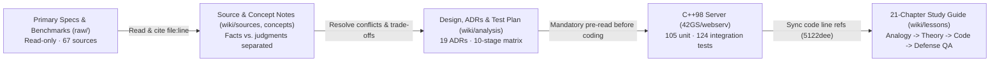

# webserv-wiki

<div align="center">
  <p><strong>Citation-verified engineering knowledge base, OS benchmarks, and architecture decision records for <a href="https://github.com/42GS/webserv">42GS/webserv</a></strong></p>
  <p>
    <a href="https://github.com/42GS/webserv-wiki/releases"></a>
    <a href="LICENSE"></a>
    
    
    
  </p>
  <p><a href="README.md">한국어</a> | <strong>English</strong></p>
</div>

---

## Overview

`webserv-wiki` is an Obsidian-backed engineering knowledge base built alongside [42GS/webserv](https://github.com/42GS/webserv), a C++98 HTTP/1.1 and CGI/1.1 server written for the 42 curriculum. Instead of relying on scattered notes or assumptions, it pairs primary specifications and small OS-level experiments with line-level citations, design rationale, and a full requirement-to-test matrix.

Every factual claim in `wiki/` cites a specific line range in `raw/` (for example, `raw/rfc9112.txt:445-448`) verified by directly reading the source file. Inferred conclusions are explicitly marked as `**판단**` (judgment), and unresolved items remain tagged as `**미확인**` (unverified) under the schema rules in [CLAUDE.md](CLAUDE.md).

> **Note on Language:** The wiki pages inside `wiki/` are written in **Korean** (with English protocol terms, header names, and function identifiers preserved). This `README.en.md` serves as an English guide to the repository's structure, engineering methodology, and key findings.

| Item | Summary |
| :--- | :--- |
| Author / Period | `yoshin` / Oct 15 – Oct 29, 2026 (portfolio release: Nov 16, 2026) |
| Target Codebase | [42GS/webserv](https://github.com/42GS/webserv) (submission commit `5122dee` / dev `4db9510`) |
| Public Study Wiki | [42GS/webserv Wiki](https://github.com/42GS/webserv/wiki) (21 lessons + 13 concept pages published) |
| Primary & Observed Sources (`raw/`) | 67 sources (53 external specs/docs + 14 OS/tool measurements; 33 paired `.source.html` originals) |
| Wiki Corpus (`wiki/`) | 111 markdown pages (`66` sources, `14` concepts, `6` analysis, `21` lessons, `4` top-level docs) |
| Design & Verification | 19 ADRs, 10-stage implementation & test traceability matrix (`105` unit / `124` integration tests), mock evaluation log |

---

## Why Maintain a Separate Knowledge Base?

Building an HTTP/1.1 server under strict 42 C++98 constraints exposes gaps where the project subject (`subject.md`) and evaluation sheet (`evaluation-sheet-en.md`) either leave behavior unspecified or contradict each other:

* **Restricted syscall allowlist vs. protocol needs:** `shutdown()`, `time()`, `unlink()`/`remove()`, and `inet_ntoa()` are absent from the subject's allowed-function list, forcing deliberate choices for TCP half-close, RFC 9110 `Date` headers, request timeouts, `DELETE`, and CGI `REMOTE_ADDR`.
* **`errno` prohibition vs. `EAGAIN` loops:** The evaluation sheet allows reading/writing until `EAGAIN`, yet both the subject and evaluation sheet make inspecting `errno` after `read`/`recv`/`write`/`send` a zero-point failure.
* **macOS development vs. Ubuntu 22.04 evaluation:** `poll()` bitmasks on closed pipes, TCP RST behavior on immediate `close()`, `std::remove()` semantics on empty directories, and filename limits (bytes vs. characters) differ across the two platforms.

Rather than guessing and patching bugs late in integration, each ambiguity was resolved by ingesting official references (IETF RFCs, POSIX.1-2024, NGINX docs/source, PHP `cgi_main.c`, `siege` source) or running isolated measurement binaries inside Ubuntu 22.04 Docker containers and on macOS before writing production code.

---

## Repository Structure & Workflow



### Directory Layout

```text
webserv-wiki/
├── CLAUDE.md                # Wiki schema, citation-check criteria, and ingest/lint/coding rules
├── AGENTS.md                # Symlink to CLAUDE.md
├── pandoc/                  # Lua filters pinned for Pandoc 3.10 (only-id.lua, opengroup-body.lua)
├── raw/                     # Read-only primary sources (67) + raw HTML snapshots (33)
│   ├── subject.md           # 42 webserv subject v24.0
│   ├── evaluation-sheet*.md # 42 EvalHub English evaluation sheet (primary) & older Korean summary
│   ├── rfc*.txt             # RFC 1945, 2046, 3875, 3986, 6265, 6585, 7578, 9110, 9112, 9293
│   ├── posix-*.md           # 22 POSIX.1-2024 specs (poll, send, recv, fork, exec, pipe, dup2, etc.)
│   ├── nginx-*.md / .c      # NGINX module docs & ngx_http_request.c lingering_close excerpt
│   ├── php-* / pep-0594.md  # PHP CGI manual, sapi/cgi/cgi_main.c, Python PEP 594
│   ├── siege*.*             # siege.pod, siegerc.in, src/sock.c
│   └── *-observed-*.md      # 14 empirical OS & tool benchmark reports (macOS & Ubuntu 22.04)
└── wiki/                    # LLM-authored, human-reviewed knowledge layer (111 pages)
    ├── overview.md          # Project summary, evaluation sequence, consolidated decisions, open questions
    ├── index.md             # Full catalog of all wiki pages
    ├── source-wishlist.md   # Upstream source tracking checklist
    ├── log.md               # Append-only chronological work log
    ├── sources/             # One summary page per source (66 pages)
    ├── concepts/            # Topic references (14 pages)
    ├── analysis/            # Conflict analysis, architecture, 19 ADRs, test plan, mock eval (6 pages)
    └── lessons/             # Step-by-step code walkthroughs: ch. 00–16 + 2A, 2B, 3A, 4A (21 pages)
```

### Citation & Conversion Discipline

* **Read-based citation audits:** Automated scripts were dropped after failing to catch subtle overstatements (`MAY` turned into `MUST`, narrowed conditions omitted). All citations were audited by opening the referenced `raw/` lines directly across three full lint passes.
* **Pinned HTML-to-Markdown pipeline:** Pandoc 3.11+ changed how `<pre>` blocks without `<code>` are converted (emitting line-broken text with NBSPs instead of fenced blocks, issue #11810). Conversion was pinned to the official `pandoc/core` `3.10` Docker image with custom Lua filters ([pandoc/only-id.lua](pandoc/only-id.lua), [pandoc/opengroup-body.lua](pandoc/opengroup-body.lua)), and all 18+ HTML conversions were checked side-by-side against the original HTML.

---

## Key Engineering Decisions & Measured Findings

Selected highlights from the 19 Architecture Decision Records ([wiki/analysis/design-decisions.md](wiki/analysis/design-decisions.md)) and 14 measurement reports:

1. **Single `poll()` loop with one I/O call per readiness event** ([wiki/concepts/io-multiplexing.md](wiki/concepts/io-multiplexing.md), [raw/os-observed-pipe-poll.md](raw/os-observed-pipe-poll.md))
   * Issuing at most one `recv`/`send`/`read`/`write` per readiness notification satisfies the `errno` ban while avoiding partial starvation. Both `0` and `-1` return values close the connection cleanly.
   * Pipe experiments on macOS vs. Ubuntu showed `events=0` pipes behave differently; checking `POLLERR`/`POLLHUP` first and reading until EOF even on `POLLHUP`-only wakeups resolved cross-OS divergence.
2. **Draining before `close()` after `413` responses** ([wiki/concepts/connection-management.md](wiki/concepts/connection-management.md), [raw/close-after-413-observed.md](raw/close-after-413-observed.md))
   * Because `shutdown()` is not in the allowed-function list, calling `close()` immediately after sending `413` triggered TCP RST on macOS, causing 1 of 3 `curl` trials to fail receiving the response (and all 3 Python trials to hit `Connection reset by peer`).
   * Adopting NGINX-style `lingering_close` draining (reading and discarding incoming bytes up to idle/total caps before closing) achieved 12/12 response delivery across both OSes (`curl` and Python, 3 trials each per OS).
3. **File-mtime clock, `std::exit`, and `std::remove` under syscall constraints** ([wiki/analysis/design-decisions.md](wiki/analysis/design-decisions.md), [raw/design-checks-observed.md](raw/design-checks-observed.md))
   * Writing 1 byte to a clock file and reading its `stat()` modification time keeps timeouts and RFC 9110 `Date` headers compliant using only allowed functions; verified to match `time()` on both OSes (ADR #10).
   * Pre-`fork` `access()` checks paired with `std::exit` (after flushing stdio buffers, ADR #12) and `std::remove` (empty-directory behavior verified on both OSes, ADR #15) were chosen and documented for defense Q&A.
4. **Security & performance fixes backed by profiling** ([wiki/analysis/test-plan.md](wiki/analysis/test-plan.md), [wiki/log.md](wiki/log.md))
   * **Path safety:** Enforced segment-boundary matching for `alias` locations to block `/k../secret` escapes (ADR #14) and rejected `%2F` and above-root `..` traversal with `400` (ADRs #2, #3).
   * **Linear multipart parsing:** Fixed quadratic header scanning across 10,000 header-only parts in a 1 MB body (`8.24s` down to `0.063s`) and capped uploads at 5 files per request (ADR #18).
   * **fd exhaustion, CGI copying & header filtering:** Paused listeners briefly when `accept()` fails due to fd limits (preventing 100% CPU spin), moved 15 MB CGI output via `swap` (halving peak RSS growth from 63 MB to ~31 MB), and stripped `Proxy` (`httpoxy`, CVE-2016-5385), underscore headers, and hop-by-hop headers.
5. **Mock evaluation & stress testing** ([wiki/analysis/mock-evaluation.md](wiki/analysis/mock-evaluation.md), [wiki/analysis/test-plan.md](wiki/analysis/test-plan.md))
   * Running the full evaluation sheet end-to-end on Ubuntu 22.04 uncovered two gaps—`-std=c++98`-less compilation failing on `std::auto_ptr` warnings and a missing 0-byte `www/empty.html` for `siege`—both fixed and regression-tested.
   * Valgrind and Electric Fence reported 0 leaks and 0 memory errors across all 105 unit tests and 124 integration tests. `siege -b -c 50` sustained 100% availability over 5 minutes static (1,355,986 requests) and 3 minutes mixed workload (105,100 requests) at a steady 1.7–2.7 MB RSS; `wrk` benchmarks measured ~73,600 rps on 50 keep-alive connections and 3.4 MB peak RSS while streaming 5 MB files.

---

## Reading Guide

| Goal | Starting Pages | Contents |
| :--- | :--- | :--- |
| High-level project picture | [wiki/overview.md](wiki/overview.md) · [wiki/index.md](wiki/index.md) | Evaluation flow, key conclusions, full catalog of 111 pages |
| Architecture & ADRs | [wiki/analysis/design.md](wiki/analysis/design.md) · [wiki/analysis/design-decisions.md](wiki/analysis/design-decisions.md) | 8-module architecture, Connection FSM, 19 ADRs |
| Spec conflicts & test matrix | [wiki/analysis/subject-vs-evaluation.md](wiki/analysis/subject-vs-evaluation.md) · [wiki/analysis/test-plan.md](wiki/analysis/test-plan.md) · [wiki/analysis/mock-evaluation.md](wiki/analysis/mock-evaluation.md) | 12 spec conflicts, test traceability table, mock eval notes |
| Config syntax & topic specs | [wiki/concepts/configuration-syntax.md](wiki/concepts/configuration-syntax.md) · [wiki/concepts/cgi.md](wiki/concepts/cgi.md) | 12 directives, 19 observed error messages, CGI & security specs |
| Guided code study (21 chapters) | [wiki/lessons/00-guide.md](wiki/lessons/00-guide.md) | Analogy → theory → `file:line` walkthrough → defense QA (ch. 15) |

### Opening Locally & Reproducing HTML Conversions

* **Obsidian Vault:** Open the repository root as an Obsidian vault to browse `[[wikilinks]]`, callouts, and Mermaid diagrams natively.
* **Rebuilding HTML sources:** HTML-to-GFM conversions under `raw/` use the pinned Pandoc `3.10` Docker image and Lua filters in `pandoc/`:

```sh
IMG=pandoc/core@sha256:8d7467e8ee40b0365a344c3d41067d6d2349da52e9961e4229f331094806fb14
docker run --rm -v <input-dir>:/in:ro -v "$PWD/pandoc":/f:ro "$IMG" \
  -f html -t gfm --wrap=none -M keep-id=<element-id> -L /f/only-id.lua /in/<file>.source.html
```

---

## Related Repositories & License

* **Server Implementation:** [42GS/webserv](https://github.com/42GS/webserv) — C++98 single-`poll()` HTTP/1.1 & CGI/1.1 server
* **Public Study Wiki:** [42GS/webserv Wiki](https://github.com/42GS/webserv/wiki) — Converted edition of the 21 lesson chapters and 13 concept guides
* **License:** Original documentation, wiki notes (`wiki/`), and Pandoc filters (`pandoc/`) are licensed under the [MIT License](LICENSE). Third-party archival sources under `raw/` remain governed by their respective upstream licenses.
