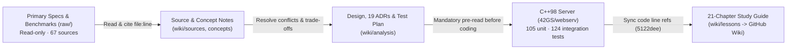

<div align="center">
  <h1>webserv-wiki</h1>
  <p>Citation-verified engineering knowledge base, OS benchmarks, and architecture decision records for <a href="https://github.com/42GS/webserv">42GS/webserv</a></p>
  <p>
    <a href="https://github.com/42GS/webserv-wiki/releases"></a>
    <a href="LICENSE"></a>
    
    
    
  </p>
  <p><a href="README.md">한국어</a> | <strong>English</strong></p>
</div>

---

## Description

`webserv-wiki` is an Obsidian-backed engineering knowledge base built alongside [42GS/webserv](https://github.com/42GS/webserv), a C++98 HTTP/1.1 and CGI/1.1 server written for the 42 curriculum.
Instead of relying on scattered notes, it enforces a **raw source (`raw/`) → structured wiki (`wiki/`) → server code (`webserv`)** workflow defined in [CLAUDE.md](CLAUDE.md). Every factual claim cites exact line numbers (`raw/rfc9112.txt:445-448`) verified by opening the source file directly, while inferred choices (`**판단**`) and unresolved questions (`**미확인**`) are kept explicitly separated.

> **Language Note:** Wiki pages under `wiki/` are authored in **Korean** (preserving English protocol terms, header names, and system identifiers). This `README.en.md` provides an English overview of the repository's structure, methodology, and key findings.

### Repository Summary

| Item | Details |
| :--- | :--- |
| Author / Timeline | `yoshin` / Oct 15 – Oct 29, 2026 (portfolio release: Nov 16, 2026) |
| Target Codebase | [42GS/webserv](https://github.com/42GS/webserv) (submission commit `5122dee` / dev `4db9510`) |
| Public Study Wiki | [42GS/webserv Wiki](https://github.com/42GS/webserv/wiki) (21 lessons + 13 concept pages published) |
| Primary & Observed Sources (`raw/`) | 67 sources (53 upstream specs/docs + 14 OS/tool measurement reports; 33 paired `.source.html` files) |
| Wiki Corpus (`wiki/`) | 111 markdown pages (`66` sources, `14` concepts, `6` analysis, `21` lessons, `4` top-level docs) |
| Design & Verification | 19 ADRs, 10-stage implementation & test traceability matrix (`105` unit / `124` integration tests), mock evaluation log |

### Core Structure & Discipline

* **Why Maintain a Separate Knowledge Base?**
  * Under strict 42 C++98 constraints, the subject (`subject.md`) and evaluation sheet (`evaluation-sheet-en.md`) leave protocol details unspecified or contradict each other—such as allowing `EAGAIN` loops while banning `errno` inspection, and omitting `shutdown()`, `time()`, `remove()`, and `inet_ntoa()` from the allowed-function list.
  * Rather than guessing and patching bugs late, official specs (IETF RFCs, POSIX.1-2024, NGINX docs/source, PHP `cgi_main.c`, `siege` source) and small macOS / Ubuntu 22.04 measurement programs were archived in `raw/` before committing to design choices.
* **Citation Integrity & Reproducible HTML Conversion**
  * Scripted citation checks missed subtle distortions (`MAY` overstated as `MUST` or dropped conditions), so they were replaced with direct read-based audits across three full lint passes.
  * Because Pandoc 3.11+ converts `<pre>` blocks without `<code>` into line-broken text with NBSPs (#11810), HTML-to-GFM conversion is pinned to the `pandoc/core` `3.10` Docker image with custom Lua filters ([only-id.lua](pandoc/only-id.lua), [opengroup-body.lua](pandoc/opengroup-body.lua)) and verified section by section against the saved `.source.html`.
* **Implementation-Synced Architecture & Study Notes**
  * [wiki/analysis/](wiki/analysis/design.md) captures the 8-module architecture, 19 ADRs, 10-stage plan, requirement-to-test matrix, and mock evaluation findings.
  * [wiki/lessons/](wiki/lessons/00-guide.md) walks through the server across 21 chapters (analogy → theory → `file:line` code → design rationale → defense Q&A), with the learning and concept pages also published to [42GS/webserv Wiki](https://github.com/42GS/webserv/wiki).

### Knowledge Pipeline



The full schema, citation rules, and workflow checkpoints are documented in [CLAUDE.md](CLAUDE.md).

### Key Decisions & Measured Findings

* **Single `poll()` loop with one I/O call per readiness event** ([io-multiplexing.md](wiki/concepts/io-multiplexing.md), [os-observed-pipe-poll.md](raw/os-observed-pipe-poll.md)): Issuing at most one `recv`/`send`/`read`/`write` per readiness notification avoids inspecting `errno` after I/O, treating both `0` and `-1` as connection teardown. Pipe experiments on macOS vs. Ubuntu established checking `POLLERR`/`POLLHUP` first and reading to EOF even on `POLLHUP`-only wakeups.
* **Draining before `close()` after `413` responses** ([connection-management.md](wiki/concepts/connection-management.md), [close-after-413-observed.md](raw/close-after-413-observed.md)): Without `shutdown()`, calling `close()` right after `413` caused TCP RST on macOS, breaking 1 of 3 `curl` runs (and hitting `Connection reset by peer` on all 3 Python runs). Adopting NGINX-style `lingering_close` draining ([ngx_http_request.c](raw/nginx-src-ngx_http_request.c)) yielded 12/12 successful response deliveries across both macOS and Ubuntu 22.04 (`curl` and Python, 3 trials each).
* **File-mtime clock, `std::exit`, and `std::remove` under syscall limits** ([design-decisions.md](wiki/analysis/design-decisions.md), [design-checks-observed.md](raw/design-checks-observed.md)): Writing 1 byte to a clock file and reading its `stat()` mtime drives timeouts and RFC 9110 `Date` headers using only allowed calls, verified to match `time()` on both OSes (ADR #10). Pre-`fork` `access()` checks paired with `std::exit` (flushing stdio buffers beforehand, ADR #12) and `std::remove` (empty-directory semantics measured on both OSes, ADR #15) were adopted and documented for evaluation defense.
* **Profiling-driven security & performance fixes** ([test-plan.md](wiki/analysis/test-plan.md), [log.md](wiki/log.md)): Segment-boundary matching on `alias` locations blocked `/k../secret` escapes (ADR #14), and bounding multipart header scans to each part reduced 10,000-part 1 MB parsing from `8.24s` to `0.063s`. Listener backoff on `accept()` fd exhaustion stopped 100% CPU spin, `swap`-based 15 MB CGI output handling cut peak memory growth from `63 MB` to `~31 MB`, and CGI header filtering stripped `Proxy` (`httpoxy`, CVE-2016-5385), underscore headers, and hop-by-hop headers.
* **Mock evaluation & load/leak audits** ([mock-evaluation.md](wiki/analysis/mock-evaluation.md), [test-plan.md](wiki/analysis/test-plan.md)): Running the full evaluation checklist on Ubuntu 22.04 exposed `-std=c++98`-less `std::auto_ptr` build failures and a missing 0-byte `www/empty.html`, both fixed and regression-tested. Valgrind and Electric Fence passed all 105 unit and 124 integration tests with 0 leaks/errors; `siege -b -c 50` held 100% availability over 5 minutes static (1,355,986 requests) and 3 minutes mixed (105,100 requests) at 1.7–2.7 MB RSS, while `wrk` recorded ~73,600 rps on 50 keep-alive connections and 3.4 MB peak RSS streaming 5 MB files.

### Release History

Milestones from `wiki/log.md` and the commit history are tagged and published as GitHub Releases.

| Tag | Commit | Summary |
| :--- | :--- | :--- |
| `v0.1.0` | `894c2bf` | Primary spec ingest, initial OS/NGINX checks, pinned Pandoc 3.10, two citation audits |
| `v0.2.0` | `338b710` | Deep runtime checks (`siege`, `php-cgi`, `valgrind`, `413` drain), architecture design & plan |
| `v0.3.0` | `ae17108` | Steps 0–9 implementation logs, 18 ADRs, requirement-to-test plan, stability audits |
| `v0.4.0` | `6477e28` | Post-implementation 3rd audit, Ubuntu 22.04 mock evaluation, 17-chapter study guide |
| `v0.5.0` | `80a6b6d` | CGI hardening, logging ADR #19, `wrk` benchmarks, supplementary lessons (`2A`–`4A`), GitHub Wiki sync |
| `v1.0.0` | `4df70ed` | Bilingual portfolio README, MIT license with `raw/` notice, `AGENTS.md`, and repo metadata |

---

## Instructions

### Opening Locally & Rebuilding HTML

* **Obsidian Vault:** Open the repository root as an Obsidian vault to render `[[wikilinks]]`, callouts (`> [!tip]`, `> [!danger]`, collapsible questions), and Mermaid diagrams natively.
* **Reproducing HTML conversions (Pandoc 3.10):** HTML-to-GFM files in `raw/` were generated with the pinned Pandoc image and Lua filters under `pandoc/`:

```sh
IMG=pandoc/core@sha256:8d7467e8ee40b0365a344c3d41067d6d2349da52e9961e4229f331094806fb14
docker run --rm -v <input-dir>:/in:ro -v "$PWD/pandoc":/f:ro "$IMG" \
  -f html -t gfm --wrap=none -M keep-id=<element-id> -L /f/only-id.lua /in/<file>.source.html
```

### Reading Guide

| Goal | Starting Pages | Contents |
| :--- | :--- | :--- |
| High-level project picture | [wiki/overview.md](wiki/overview.md) · [wiki/index.md](wiki/index.md) | Evaluation flow, key conclusions, full catalog of 111 pages |
| Architecture & ADRs | [wiki/analysis/design.md](wiki/analysis/design.md) · [wiki/analysis/design-decisions.md](wiki/analysis/design-decisions.md) | 8-module architecture, Connection FSM, 19 ADRs |
| Spec conflicts & test matrix | [wiki/analysis/subject-vs-evaluation.md](wiki/analysis/subject-vs-evaluation.md) · [wiki/analysis/test-plan.md](wiki/analysis/test-plan.md) · [wiki/analysis/mock-evaluation.md](wiki/analysis/mock-evaluation.md) | 12 spec conflicts, test traceability table, mock eval notes |
| Config syntax & topic specs | [wiki/concepts/configuration-syntax.md](wiki/concepts/configuration-syntax.md) · [wiki/concepts/cgi.md](wiki/concepts/cgi.md) | 12 directives, 19 observed error messages, CGI & security specs |
| Guided code study (21 chapters) | [wiki/lessons/00-guide.md](wiki/lessons/00-guide.md) | Analogy → theory → `file:line` walkthrough → defense Q&A (ch. 15) |

<details>
<summary><strong>Directory Structure (expand)</strong></summary>

```text
webserv-wiki/
├── CLAUDE.md                # Wiki schema, citation-check criteria, and ingest/lint/coding rules
├── AGENTS.md                # Symlink to CLAUDE.md
├── LICENSE                  # MIT License + third-party raw/ sources notice
├── README.md / README.en.md # Korean & English repository guides
├── pandoc/                  # Pandoc 3.10 Lua filters (only-id.lua, opengroup-body.lua)
├── raw/                     # Read-only primary sources (67) + raw HTML snapshots (33)
│   ├── subject.md           # 42 webserv subject v24.0
│   ├── evaluation-sheet*.md # 42 EvalHub English evaluation sheet (primary) & older Korean summary
│   ├── rfc*.txt             # RFC 1945, 2046, 3875, 3986, 6265, 6585, 7578, 9110, 9112, 9293
│   ├── posix-*.md           # 22 POSIX.1-2024 system call specifications
│   ├── nginx-*.md / .c      # 6 NGINX module docs & ngx_http_request.c lingering_close excerpt
│   ├── php-* / pep-0594.md  # PHP CGI manual, sapi/cgi/cgi_main.c, Python PEP 594
│   ├── siege*.*             # siege.pod, siegerc.in, src/sock.c
│   └── *-observed-*.md      # 14 empirical OS & tool benchmark reports (macOS & Ubuntu 22.04)
└── wiki/                    # LLM-authored, human-reviewed knowledge layer (111 pages)
    ├── overview.md          # Project summary, evaluation sequence, consolidated decisions, open questions
    ├── index.md             # Full catalog of all wiki pages
    ├── source-wishlist.md   # Upstream source tracking checklist
    ├── log.md               # Append-only chronological work log
    ├── sources/             # One summary page per source (66 pages)
    ├── concepts/            # Topic references (14 pages)
    ├── analysis/            # Conflict analysis, architecture, 19 ADRs, test plan, mock eval (6 pages)
    └── lessons/             # Step-by-step code walkthroughs: ch. 00–16 + 2A, 2B, 3A, 4A (21 pages)
```

</details>

---

## Resources

### Collected Primary Sources (`raw/` — 67 Sources)

* **42 Curriculum:** `webserv` subject v24.0, 42 EvalHub English evaluation sheet (plus superseded Korean summary)
* **HTTP / URI / MIME / TCP Specs:** RFC 9110 (Semantics), RFC 9112 (HTTP/1.1), RFC 1945 (HTTP/1.0), RFC 3875 (CGI/1.1), RFC 3986 (URI), RFC 7578 & RFC 2046 (`multipart/form-data`), RFC 6265 (Cookies), RFC 6585 (`431`), RFC 9293 (TCP), IANA HTTP Status Code Registry
* **POSIX.1-2024 (22 Specs):** `poll`, `<signal.h>`, `send`, `recv`, `waitpid`, `bind`, `fcntl`, `_Exit`, `remove`, `rmdir`, `socket`, `listen`, `accept`, `read`, `write`, `open`, `close`, `errno`, `fork`, `exec`, `pipe`, `dup`
* **NGINX / PHP / Python / Tooling / C++ Guides:** 6 NGINX module docs & `ngx_http_request.c` `lingering_close` source, PHP CGI manual & `sapi/cgi/cgi_main.c`, Python PEP 594, `siege` manual/config/`src/sock.c`, C++ Core Guidelines, Google C++ Style Guide
* **OS & Tool Benchmarks (14 Reports):** Direct measurements on macOS and Ubuntu 22.04 containers for `bind()`, pipe `poll()`, `413` drain, `std::remove`, `php-cgi`, `valgrind`, `leaks`, Electric Fence, `siege 4.0.7`, and default fd limits

### Related Repositories & License

* **Server Implementation:** [42GS/webserv](https://github.com/42GS/webserv) — C++98 single-`poll()` HTTP/1.1 & CGI/1.1 server
* **Public Study Wiki:** [42GS/webserv Wiki](https://github.com/42GS/webserv/wiki) — Converted edition of the 21 lesson chapters and 13 concept guides
* **License:** Original documentation, wiki notes (`wiki/`), and Pandoc filters (`pandoc/`) are licensed under the [MIT License](LICENSE). Third-party archival sources under `raw/` remain governed by their respective upstream licenses.

### AI Collaboration

This repository was maintained by `yoshin` defining source scope, design decisions, and code baselines while using an LLM (Claude) to draft, cite-check, and organize pages under [CLAUDE.md](CLAUDE.md).

* The LLM paired every factual statement with `file:line` citations and explicitly tagged inferred judgments (`**판단**`) and open items (`**미확인**`).
* All citations were audited through three full read-based passes after dropping unreliable verification scripts, and the 19 ADRs, OS benchmarks, and mock evaluation were reviewed and confirmed by the author.
