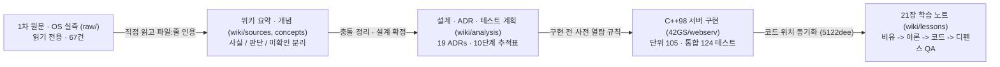

# webserv-wiki

<div align="center">
  <p><strong>C++98 HTTP/1.1 &amp; CGI/1.1 웹 서버(<a href="https://github.com/42GS/webserv">42GS/webserv</a>)의 설계 근거, 1차 명세 인용, OS 실측, 아키텍처 결정 기록(ADR)을 모은 엔지니어링 지식 베이스</strong></p>
  <p>
    <a href="https://github.com/42GS/webserv-wiki/releases"></a>
    <a href="LICENSE"></a>
    
    
    
  </p>
  <p><strong>한국어</strong> | <a href="README.en.md">English</a></p>
</div>

---

## 프로젝트 개요

`webserv-wiki`는 42 `webserv` 과제([42GS/webserv](https://github.com/42GS/webserv))를 구현하면서 흩어지기 쉬운 프로토콜 해석, 시스템 콜 동작 차이, 설계 결정 이유, 테스트 근거를 한곳에 기록하고 검증한 **인용 기반 엔지니어링 위키(Obsidian Vault)**다.

단순 메모장이 아니라 **원문(`raw/`) → 정리(`wiki/`) → 구현(`webserv`)** 흐름을 강제하는 작업 규칙([CLAUDE.md](CLAUDE.md)) 위에서 운영했다. 위키의 모든 사실 주장은 원본 파일의 줄 번호(`raw/rfc9112.txt:445-448`)를 직접 열어 대조해 인용했고, 문서에 없는 추론은 `**판단**`, 아직 검증하지 못한 항목은 `**미확인**`으로 분리해 두었다.

| 항목 | 내용 |
| :--- | :--- |
| 작성자 / 기간 | `yoshin` / 2026.10.15 ~ 2026.10.29 (포트폴리오 정리: 2026.11.16) |
| 대상 구현 저장소 | [42GS/webserv](https://github.com/42GS/webserv) (제출 커밋 `5122dee` / 개발 `4db9510` 기준) |
| 공개 학습 위키 | [42GS/webserv Wiki](https://github.com/42GS/webserv/wiki) (레슨 21장·개념 13장 변환 게시) |
| 1차 원문·실측 (`raw/`) | 총 67건 (외부 원문 53건 + OS·도구 실측 리포트 14건, HTML 원본 33개 병행 보관) |
| 위키 문서 (`wiki/`) | 총 111편 (`sources` 66편, `concepts` 14편, `analysis` 6편, `lessons` 21편, 인덱스·개요·위시리스트·로그 4편) |
| 설계·검증 산출물 | 아키텍처 의사결정(ADR) 19건, 10단계 구현·테스트 추적표(단위 105·통합 124건), 모의 평가 리포트 |

---

## 왜 별도의 지식 저장소를 만들었는가

42 `webserv`는 C++98 제약 아래에서 NGINX 스타일 설정 파일, HTTP/1.1 메시지 파싱, 파일 업로드, CGI/1.1 실행을 직접 구현해야 한다. 문제는 과제 명세(`subject.md`)와 평가표(`evaluation-sheet-en.md`)가 세부 동작을 비워 두거나 서로 부딪히는 지점이 많다는 점이었다.

* **허용 함수 목록과 프로토콜 요구의 충돌**: `shutdown()`, `time()`, `unlink()`/`remove()`, `inet_ntoa()`가 허용 목록에 빠져 있어 HTTP half-close, `Date` 헤더, 타임아웃, `DELETE`, CGI `REMOTE_ADDR` 구현 방식을 원문과 실험으로 확정해야 했다.
* **`errno` 금지 vs `EAGAIN` 반복 허용의 모순**: 평가표는 `EAGAIN`까지 반복 I/O를 허용하지만, subject와 평가표 모두 `read`/`write` 뒤 `errno` 검사를 0점 조건으로 둔다.
* **macOS(개발) ↔ Ubuntu 22.04(평가) 동작 차이**: 한쪽이 닫힌 pipe에 대한 `poll()` 이벤트 비트(`POLLHUP`/`POLLIN`), 즉시 `close()` 시 TCP RST 발생 여부, `std::remove()`의 빈 디렉토리 삭제 동작, 파일 이름 상한(바이트 vs 글자 수)이 두 OS에서 다르게 나타났다.

추측으로 코드를 짜고 뒤늦게 디버깅하는 대신, 공식 명세(RFC·POSIX·NGINX·PHP 소스)를 수집하고 Docker 컨테이너에서 작은 C/C++ 실험 프로그램으로 직접 측정한 결과를 `raw/`에 고정한 뒤, 그 근거 위에서만 설계와 테스트를 진행했다.

---

## 지식 베이스 구조와 운영 규칙



### 디렉토리 구성

```text
webserv-wiki/
├── CLAUDE.md                # 위키 스키마, 인용 대조 기준, Ingest/Query/Lint/구현 절차
├── AGENTS.md                # CLAUDE.md 심볼릭 링크 (에이전트 호환용)
├── pandoc/                  # HTML → GFM 변환용 Pandoc 3.10 Lua 필터 (only-id.lua, opengroup-body.lua)
├── raw/                     # 읽기 전용 1차 자료 67건 + 원본 HTML 33개
│   ├── subject.md           # 42 webserv subject v24.0
│   ├── evaluation-sheet*.md # 42 EvalHub 영어 원문 (1차 근거) 및 구버전 한국어 정리본
│   ├── rfc*.txt             # RFC 1945, 2046, 3875, 3986, 6265, 6585, 7578, 9110, 9112, 9293
│   ├── posix-*.md           # POSIX.1-2024 시스템 콜 명세 22건 (poll, send, recv, fork, exec 등)
│   ├── nginx-*.md / .c      # NGINX core/index/autoindex/rewrite 문서 및 ngx_http_request.c 발췌
│   ├── php-* / pep-0594.md  # PHP CGI 매뉴얼, sapi/cgi/cgi_main.c, Python PEP 594
│   ├── siege*.*             # siege.pod, siegerc.in, src/sock.c
│   └── *-observed-*.md      # macOS · Ubuntu 22.04 직접 실측 14건
└── wiki/                    # LLM이 작성하고 사람이 검토한 지식 계층 (111편)
    ├── overview.md          # 과제 전체 요약, 평가 순서, 종합 판단, 열린 질문
    ├── index.md             # 전체 페이지 카탈로그
    ├── source-wishlist.md   # 수집 대상 공식 소스 추적표
    ├── log.md               # 시간순 작업 기록 (append-only)
    ├── sources/             # 원문 1건당 요약 페이지 (66편)
    ├── concepts/            # 주제별 규범·동작 정리 (14편)
    ├── analysis/            # 모순 분석, 클래스 설계, ADR 19건, 구현·테스트 계획, 모의 평가 (6편)
    └── lessons/             # 코드 학습 노트 00~16장 + 기초 보충 2A·2B·3A·4A (21편)
```

### 품질 및 인용 검증 방식

* **원문 기반 직접 대조**: 초기에는 Python 검증 스크립트를 썼으나 문맥과 규범 강도(`MAY` vs `MUST`) 왜곡을 잡지 못해 폐기하고, 작성·감사 시 원문 줄을 직접 열어 대조하는 규칙으로 전환했다([CLAUDE.md](CLAUDE.md), [wiki/log.md](wiki/log.md)).
* **HTML 변환 재현성 고정**: Pandoc 3.11부터 `<code>` 없는 `<pre>`를 줄바꿈 텍스트와 NBSP로 변환하는 변경(#11810) 때문에 코드 블록이 깨지는 것을 확인하고, Pandoc `3.10` Docker 이미지 digest와 Lua 필터([pandoc/only-id.lua](pandoc/only-id.lua), [pandoc/opengroup-body.lua](pandoc/opengroup-body.lua))로 고정한 뒤 원본 HTML과 절 단위로 대조했다.
* **3차례 전체 감사(Lint)**: 소스 수집 직후 2회, 구현 완료 후 1회 전체 위키 페이지와 코드 줄 번호를 대조해 과장된 주장과 오래된 설계 문구를 정정했다.

---

## 핵심 의사결정 및 실측 하이라이트

위키에 기록된 19건의 설계 결정([wiki/analysis/design-decisions.md](wiki/analysis/design-decisions.md))과 14건의 OS·도구 실측 중 구현 방향을 결정지은 주요 사례다.

1. **`poll()` 단일 루프와 readiness당 1회 I/O** ([wiki/concepts/io-multiplexing.md](wiki/concepts/io-multiplexing.md), [raw/os-observed-pipe-poll.md](raw/os-observed-pipe-poll.md))
   * `EAGAIN` 반복 허용(평가표)과 `errno` 금지(subject)의 충돌을 피하기 위해 readiness 알림 1회당 `recv`/`send`/`read`/`write`를 1번만 수행하고, 반환값 `0`·`-1`은 모두 연결 종료로 처리했다.
   * macOS와 Ubuntu 컨테이너에서 닫힌 pipe의 `poll()` 비트를 실측해, `POLLERR`·`POLLHUP`을 먼저 검사하고 `POLLHUP`만 와도 EOF까지 읽는 공통 처리 순서를 정했다.
2. **413 응답 후 TCP RST 회피를 위한 Drain 종료** ([wiki/concepts/connection-management.md](wiki/concepts/connection-management.md), [raw/close-after-413-observed.md](raw/close-after-413-observed.md))
   * 허용 함수에 `shutdown()`이 없어 413 응답 후 즉시 `close()`를 호출했더니 macOS에서 TCP RST가 발생해 `curl` 3회 시험 중 1회가 응답을 받지 못했다(`python` 3회도 모두 `Connection reset by peer`).
   * NGINX의 `lingering_close`([raw/nginx-src-ngx_http_request.c](raw/nginx-src-ngx_http_request.c)) 방식을 참고해 일정 시간 읽고 버린 뒤 `close()`하도록 바꾸자 macOS·Ubuntu 22.04 양쪽(`curl`·`python` 각 3회씩 총 12회) 모두 응답 수신에 성공했다.
3. **허용 함수 제약을 우회한 시계, `std::exit`, `std::remove`** ([wiki/analysis/design-decisions.md](wiki/analysis/design-decisions.md), [raw/design-checks-observed.md](raw/design-checks-observed.md))
   * `time()` 없이 타임아웃과 RFC 9110 `Date` 헤더를 처리하기 위해, 루프 바퀴마다 시계 파일에 1바이트를 쓰고 `stat()`의 수정 시각을 읽어 `time()`과 초 단위로 일치함을 두 OS에서 확인했다(ADR #10).
   * CGI 자식 `execve` 실패 시에는 `fork` 전 `access` 검사 + `std::exit`(`fork` 직전 stdout/stderr flush 필수, ADR #12), 파일 삭제는 `std::remove`(빈 디렉토리 삭제 동작을 macOS·Ubuntu에서 실측, ADR #15)를 채택하고 디펜스 논리를 문서화했다.
4. **보안·성능 병목 실측 기반 개선** ([wiki/analysis/test-plan.md](wiki/analysis/test-plan.md), [wiki/log.md](wiki/log.md))
   * **경로 보안**: `alias` location의 `/k../secret` 우회를 막기 위해 세그먼트 경계 매칭을 적용했고(ADR #14), `%2F`·`..` 상향 이동은 400으로 차단했다(ADR #2, #3).
   * **multipart O(n) 파싱**: 빈 줄 없는 part 1만 개(1MB) 본문에서 헤더 끝을 본문 끝까지 훑던 버그(8.24초 소요)를 part 내부로 제한해 0.063초로 줄이고, 요청당 업로드 파일을 5개로 제한했다(ADR #18).
   * **fd 고갈·CGI 복사·보안 헤더**: `accept()` 실패 시 listener를 1초/연결 종료 시점까지 일시 중단해 CPU 100% 스핀을 막았고, CGI 출력 15MB 응답 메모리 증가를 `swap`으로 63MB→31MB 수준으로 낮췄으며, `Proxy`(`httpoxy`, CVE-2016-5385)·`_` 포함 헤더 전달과 hop-by-hop 응답 헤더를 차단했다.
5. **모의 평가 및 부하·누수 검증** ([wiki/analysis/mock-evaluation.md](wiki/analysis/mock-evaluation.md), [wiki/analysis/test-plan.md](wiki/analysis/test-plan.md))
   * 평가표 순서대로 수행한 Ubuntu 22.04 모의 평가에서 `-std=c++98` 없는 빌드 실패(`std::auto_ptr` 경고)와 `siege`용 0바이트 `empty.html` 누락 2건을 찾아 수정했다.
   * Valgrind·Electric Fence 아래 단위 105건·통합 124건 테스트에서 오류·누수 0을 확인했고, `siege -b -c 50` 5분 정적 부하 1,355,986건·혼합 3분 105,100건에서 availability 100%(RSS 1.7~2.7MB 유지)를 기록했다. `wrk` 비교 실측에서도 keep-alive 50연결 약 73,600 rps, 5MB 파일 스트리밍 최대 RSS 3.4MB를 확인했다.

---

## 문서 탐색 가이드

목적에 따라 아래 문서부터 읽으면 전체 흐름을 빠르게 파악할 수 있다.

| 목적 | 추천 시작 문서 | 설명 |
| :--- | :--- | :--- |
| 과제 전체 구조와 핵심 결론 파악 | [wiki/overview.md](wiki/overview.md) · [wiki/index.md](wiki/index.md) | 평가 채점 흐름, 종합 판단, 전체 111편 카탈로그 |
| 아키텍처·설계 결정 근거 검토 | [wiki/analysis/design.md](wiki/analysis/design.md) · [wiki/analysis/design-decisions.md](wiki/analysis/design-decisions.md) | 8개 모듈 구조, Connection 상태기계, ADR 19건 |
| 명세 모순 및 테스트·평가 기록 | [wiki/analysis/subject-vs-evaluation.md](wiki/analysis/subject-vs-evaluation.md) · [wiki/analysis/test-plan.md](wiki/analysis/test-plan.md) · [wiki/analysis/mock-evaluation.md](wiki/analysis/mock-evaluation.md) | 모순 12개 쟁점, 요구사항별 테스트 추적표, 모의 평가 메모 |
| 설정 문법 및 개념별 상세 레퍼런스 | [wiki/concepts/configuration-syntax.md](wiki/concepts/configuration-syntax.md) · [wiki/concepts/cgi.md](wiki/concepts/cgi.md) | 지시어 12개, 오류 메시지 실측 19종, CGI·보안·연결 관리 |
| 코드 처음부터 학습 (21장) | [wiki/lessons/00-guide.md](wiki/lessons/00-guide.md) | 비유 → 이론 → `file:line` 코드 → 디펜스 예상 질문(15장) |

### 로컬에서 위키 열기 및 HTML 재변환

* **Obsidian Vault로 열기**: 저장소 루트를 Obsidian Vault로 열면 `[[concepts/io-multiplexing]]` 위키링크와 콜아웃(`> [!tip]`, `> [!danger]`, 접힌 확인 문제)이 그대로 렌더링된다.
* **HTML 소스 재변환 (Pandoc 3.10)**: `raw/`의 HTML 문서는 아래 고정 이미지와 필터로 변환했다.

```sh
IMG=pandoc/core@sha256:8d7467e8ee40b0365a344c3d41067d6d2349da52e9961e4229f331094806fb14
docker run --rm -v <input-dir>:/in:ro -v "$PWD/pandoc":/f:ro "$IMG" \
  -f html -t gfm --wrap=none -M keep-id=<element-id> -L /f/only-id.lua /in/<file>.source.html
```

---

## 연관 저장소 및 라이선스

* **구현 코드**: [42GS/webserv](https://github.com/42GS/webserv) — C++98 단일 `poll()` HTTP/1.1 & CGI/1.1 서버
* **공개 학습 위키**: [42GS/webserv Wiki](https://github.com/42GS/webserv/wiki) — 본 저장소의 학습 노트 21장과 개념 문서 13장을 GitHub Wiki 형식으로 변환해 게시한 버전
* **라이선스**: 직접 작성한 위키(`wiki/`), Pandoc 필터(`pandoc/`), 문서 파일은 [MIT License](LICENSE)를 따르며, `raw/` 디렉토리의 외부 명세·원문 자료는 각 원출처의 저작권과 라이선스를 따른다.
