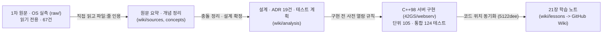

<div align="center">
  <h1>webserv-wiki</h1>
  <p>C++98 HTTP/1.1 &amp; CGI/1.1 웹 서버(<a href="https://github.com/42GS/webserv">42GS/webserv</a>)의 설계 근거, 1차 명세 인용, OS 실측, 아키텍처 결정 기록(ADR)을 정리한 엔지니어링 지식 베이스</p>
  <p>
    <a href="https://github.com/42GS/webserv-wiki/releases"></a>
    <a href="LICENSE"></a>
    
    
    
  </p>
  <p><strong>한국어</strong> | <a href="README.en.md">English</a></p>
</div>

---

## Description

`webserv-wiki`는 [42GS/webserv](https://github.com/42GS/webserv)를 설계·구현·검증하는 동안 흩어지기 쉬운 프로토콜 해석, 시스템 콜 동작 차이, 아키텍처 결정 근거를 한곳에 모아 검증한 **인용 기반 엔지니어링 위키(Obsidian Vault)**다.
단순 메모가 아니라 **원문(`raw/`) → 정리(`wiki/`) → 구현(`webserv`)** 순서를 강제하는 작업 규칙([CLAUDE.md](CLAUDE.md)) 위에서 운영했다. 위키의 모든 사실 주장은 원문 `파일:줄`을 직접 열어 대조했고, 문서에 없는 추론(`**판단**`)과 미확인 항목(`**미확인**`)은 본문에서 분리해 표기했다.

### 저장소 요약

| 항목 | 내용 |
| :--- | :--- |
| 작성자 / 기간 | `yoshin` / 2026.10.15 ~ 2026.10.29 (포트폴리오 정리: 2026.11.16) |
| 대상 구현 저장소 | [42GS/webserv](https://github.com/42GS/webserv) (제출 커밋 `5122dee` / 개발 `4db9510` 기준) |
| 공개 학습 위키 | [42GS/webserv Wiki](https://github.com/42GS/webserv/wiki) (레슨 21장·개념 13장 변환 게시) |
| 1차 원문·실측 (`raw/`) | 총 67건 (외부 원문 53건 + OS·도구 실측 14건, `.source.html` 원본 33개 보관) |
| 위키 문서 (`wiki/`) | 총 111편 (`sources` 66편, `concepts` 14편, `analysis` 6편, `lessons` 21편, 최상위 문서 4편) |
| 설계·검증 산출물 | 아키텍처 의사결정(ADR) 19건, 10단계 구현·테스트 추적표(단위 105·통합 124건), 모의 평가 리포트 |

### 주요 구성 및 운영 원칙

* **왜 별도의 지식 저장소를 분리했는가**
  * 42 과제 명세(`subject.md`)와 평가표(`evaluation-sheet-en.md`) 사이에는 `EAGAIN` 반복 허용 vs `errno` 금지 같은 모순과, `shutdown()`·`time()`·`remove()`·`inet_ntoa()` 미허용 등 세부 공백이 많다.
  * 추측으로 구현하고 뒤늦게 고치는 대신, 공식 RFC·POSIX·NGINX·PHP 소스를 수집하고 macOS·Ubuntu 22.04 컨테이너에서 직접 실험해 확인한 사실만 `raw/`에 고정한 뒤 설계로 넘겼다.
* **원문 기반 인용 및 변환 재현성**
  * 초기에는 스크립트로 인용을 검증했으나 규범 강도(`MAY` vs `MUST`)나 문맥 왜곡을 잡지 못해 폐기하고, 작성·감사 시 원문 줄을 직접 열어 대조하는 규칙으로 전환했다.
  * Pandoc 3.11부터 `<code>` 없는 `<pre>`를 코드 블록이 아니라 줄바꿈 텍스트와 NBSP로 바꾸는 동작(#11810)을 확인해, HTML 변환은 Pandoc `3.10` Docker digest와 Lua 필터([only-id.lua](pandoc/only-id.lua), [opengroup-body.lua](pandoc/opengroup-body.lua))로 고정했다.
  * 소스 수집 직후 2회, 구현 완료 후 1회 등 총 3차례 전체 위키 감사(Lint)를 거쳐 과장된 서술과 코드 불일치를 정정했다.
* **구현과 동기화된 학습·디펜스 자료**
  * [wiki/analysis/](wiki/analysis/design.md)에 8개 모듈 클래스 설계, 19건의 ADR, 10단계 구현 순서, 요구사항-테스트 추적표, 모의 평가 메모를 남겼다.
  * [wiki/lessons/](wiki/lessons/00-guide.md) 21개 장은 비유 → 이론 → `파일:줄` 코드 해설 → 구현 이유 → 디펜스 예상 질문 순으로 작성했고, 학습용 페이지는 [42GS/webserv Wiki](https://github.com/42GS/webserv/wiki)로도 게시했다.

### 지식 파이프라인 아키텍처



전체 작업 절차와 인용 대조 기준, 파일 규칙은 [CLAUDE.md](CLAUDE.md)에 정의했다.

### 주요 의사결정과 OS 실측 사례

* **`poll()` 단일 루프와 readiness당 1회 I/O** ([io-multiplexing.md](wiki/concepts/io-multiplexing.md), [os-observed-pipe-poll.md](raw/os-observed-pipe-poll.md)): `EAGAIN` 반복(평가표)과 `errno` 금지(subject) 충돌을 피하기 위해 readiness 1회에 I/O를 1번만 실행한다. macOS와 Ubuntu 컨테이너에서 닫힌 pipe의 `poll()` 비트를 실측해 `POLLERR`·`POLLHUP` 우선 검사 및 `POLLHUP` 단독 수신 시 EOF 읽기 규칙을 세웠다.
* **`413` 응답 후 TCP RST 회피용 Drain 종료** ([connection-management.md](wiki/concepts/connection-management.md), [close-after-413-observed.md](raw/close-after-413-observed.md)): `shutdown()` 없이 `413` 직후 `close()`를 부르면 macOS에서 TCP RST가 발생해 `curl` 3회 시험 중 1회가 응답을 받지 못했다(`python` 3회도 모두 `Connection reset by peer`). NGINX `lingering_close`([ngx_http_request.c](raw/nginx-src-ngx_http_request.c))를 참고해 일정 시간 읽고 버린 뒤 닫자 양쪽 OS(`curl`·`python` 각 3회씩 총 12회) 모두 응답을 받았다.
* **허용 함수 제약 아래 시계·`std::exit`·`std::remove` 선택** ([design-decisions.md](wiki/analysis/design-decisions.md), [design-checks-observed.md](raw/design-checks-observed.md)): `time()` 대신 시계 파일에 1바이트를 쓰고 `stat()` 수정 시각으로 `Date` 헤더와 타임아웃을 처리해 두 OS에서 `time()`과 일치함을 확인했다(ADR #10). CGI 자식 실패 시 `fork` 전 `access` 검사 + `std::exit`(stdout/stderr flush 동반, ADR #12), 삭제는 `std::remove`(빈 디렉토리 삭제 동작 실측, ADR #15)를 택했다.
* **보안·성능 병목 실측 개선** ([test-plan.md](wiki/analysis/test-plan.md), [log.md](wiki/log.md)): `alias` 세그먼트 경계 검사로 `/k../secret` 우회를 막았고(ADR #14), multipart 헤더 탐색을 part 내부로 제한해 1만 part 1MB 처리 시간을 `8.24초 → 0.063초`로 줄였다. `accept()` fd 고갈 시 listener를 일시 중단해 CPU 스핀을 막았고, CGI 15MB 출력 복사 제거(`swap`)로 최대 메모리 증가를 `63MB → ~31MB`로 낮췄으며, `Proxy`(`httpoxy`, CVE-2016-5385)·`_` 헤더·hop-by-hop 응답 헤더를 차단했다.
* **모의 평가 및 부하·누수 검증** ([mock-evaluation.md](wiki/analysis/mock-evaluation.md), [test-plan.md](wiki/analysis/test-plan.md)): Ubuntu 22.04 모의 평가에서 `-std=c++98` 미지정 빌드 실패(`std::auto_ptr`)와 `www/empty.html` 누락 2건을 찾아 해결했다. Valgrind·Electric Fence 아래 단위 105·통합 124 테스트에서 오류·누수 0을 확인했고, `siege -b -c 50` 5분 정적 1,355,986건·혼합 3분 105,100건에서 availability 100%(RSS 1.7~2.7MB), `wrk` 측정에서 keep-alive 50연결 ~73,600 rps·5MB 스트리밍 최대 RSS 3.4MB를 기록했다.

### 릴리스 이력

작업 로그(`wiki/log.md`)와 커밋 이력을 기준으로 마일스톤 태그와 GitHub Release를 발행했다.

| Tag | Commit | 주요 변경 사항 |
| :--- | :--- | :--- |
| `v0.1.0` | `894c2bf` | 핵심 명세 수집, OS·NGINX 초기 실측, Pandoc 3.10 고정 및 1차 인용 감사 2회 |
| `v0.2.0` | `338b710` | `siege`·`php-cgi`·`valgrind`·`413` Drain 심층 실측, 아키텍처 설계(`design.md`) 및 구현 계획 |
| `v0.3.0` | `ae17108` | 0–9단계 구현 기록, ADR 18건 확정, 요구사항-테스트 추적표(`test-plan.md`) 및 안정성 검증 |
| `v0.4.0` | `6477e28` | 구현 후 3차 전수 감사, Ubuntu 22.04 모의 평가 리포트, 17장 학습 노트(`wiki/lessons/`) |
| `v0.5.0` | `80a6b6d` | CGI 보안·운영 로그(ADR #19), `wrk` 성능 비교, 기초 보충 4장(`2A`–`4A`), GitHub Wiki 게시 |
| `v1.0.0` | `4df70ed` | 국·영문 포트폴리오 README, MIT 라이선스(`raw/` 고지 포함), `AGENTS.md` 및 메타데이터 정비 |

---

## Instructions

### 로컬에서 위키 열기 및 HTML 재변환

* **Obsidian Vault로 열기**: 저장소 루트를 Obsidian Vault로 열면 `[[concepts/io-multiplexing]]` 위키링크, 콜아웃(`> [!tip]`, `> [!danger]`, 접힌 확인 문제), Mermaid 다이어그램이 그대로 렌더링된다.
* **HTML 소스 재변환 (Pandoc 3.10)**: `raw/`의 HTML 문서는 아래 고정 이미지와 `pandoc/` Lua 필터로 변환했다.

```sh
IMG=pandoc/core@sha256:8d7467e8ee40b0365a344c3d41067d6d2349da52e9961e4229f331094806fb14
docker run --rm -v <input-dir>:/in:ro -v "$PWD/pandoc":/f:ro "$IMG" \
  -f html -t gfm --wrap=none -M keep-id=<element-id> -L /f/only-id.lua /in/<file>.source.html
```

### 문서 탐색 가이드

| 목적 | 시작 문서 | 설명 |
| :--- | :--- | :--- |
| 과제 전체 요약과 핵심 결론 | [wiki/overview.md](wiki/overview.md) · [wiki/index.md](wiki/index.md) | 평가 채점 순서, 종합 판단, 전체 111편 카탈로그 |
| 아키텍처·설계 결정 근거 | [wiki/analysis/design.md](wiki/analysis/design.md) · [wiki/analysis/design-decisions.md](wiki/analysis/design-decisions.md) | 8개 모듈 책임·의존성, Connection FSM, ADR 19건 |
| 명세 모순 및 테스트·평가 기록 | [wiki/analysis/subject-vs-evaluation.md](wiki/analysis/subject-vs-evaluation.md) · [wiki/analysis/test-plan.md](wiki/analysis/test-plan.md) · [wiki/analysis/mock-evaluation.md](wiki/analysis/mock-evaluation.md) | 모순 12개 쟁점, 테스트 추적표, 모의 평가 메모 |
| 설정 문법 및 개념별 상세 규칙 | [wiki/concepts/configuration-syntax.md](wiki/concepts/configuration-syntax.md) · [wiki/concepts/cgi.md](wiki/concepts/cgi.md) | 지시어 12개, 오류 메시지 실측 19종, CGI·보안·연결 관리 |
| 코드 처음부터 학습 (21장) | [wiki/lessons/00-guide.md](wiki/lessons/00-guide.md) | 비유 → 이론 → `file:line` 코드 → 디펜스 예상 질문(15장) |

<details>
<summary><strong>디렉토리 구조 (펼치기)</strong></summary>

```text
webserv-wiki/
├── CLAUDE.md                # 위키 스키마, 인용 대조 기준, Ingest/Query/Lint/구현 절차
├── AGENTS.md                # CLAUDE.md 심볼릭 링크
├── LICENSE                  # MIT 라이선스 및 raw/ 외부 원문 저작권 고지
├── README.md / README.en.md # 국·영문 저장소 안내서
├── pandoc/                  # Pandoc 3.10 Lua 필터 (only-id.lua, opengroup-body.lua)
├── raw/                     # 읽기 전용 1차 자료 67건 + 원본 HTML 33개
│   ├── subject.md           # 42 webserv subject v24.0
│   ├── evaluation-sheet*.md # 42 EvalHub 영어 원문 (1차 근거) 및 구버전 한국어 정리본
│   ├── rfc*.txt             # RFC 1945, 2046, 3875, 3986, 6265, 6585, 7578, 9110, 9112, 9293
│   ├── posix-*.md           # POSIX.1-2024 시스템 콜 명세 22건
│   ├── nginx-*.md / .c      # NGINX 모듈 문서 6종 및 ngx_http_request.c 발췌
│   ├── php-* / pep-0594.md  # PHP CGI 매뉴얼, sapi/cgi/cgi_main.c, Python PEP 594
│   ├── siege*.*             # siege.pod, siegerc.in, src/sock.c
│   └── *-observed-*.md      # macOS · Ubuntu 22.04 직접 실측 리포트 14건
└── wiki/                    # LLM 작성·사람 검토 지식 계층 (111편)
    ├── overview.md          # 과제 전체 요약, 평가 순서, 종합 판단, 열린 질문
    ├── index.md             # 전체 페이지 카탈로그
    ├── source-wishlist.md   # 수집 대상 공식 소스 추적표
    ├── log.md               # 시간순 작업 기록 (append-only)
    ├── sources/             # 원문 1건당 요약 페이지 (66편)
    ├── concepts/            # 주제별 규범·동작 정리 (14편)
    ├── analysis/            # 모순 분석, 클래스 설계, ADR 19건, 구현·테스트 계획, 모의 평가 (6편)
    └── lessons/             # 코드 학습 노트 00~16장 + 기초 보충 2A·2B·3A·4A (21편)
```

</details>

---

## Resources

### 수집한 1차 자료 (`raw/` 67건)

* **42 과제·평가**: `webserv` subject v24.0, 42 EvalHub 영어 평가표 원문 (구버전 한국어 정리본 포함 3건)
* **HTTP / URI / MIME / TCP 명세**: RFC 9110 (Semantics), RFC 9112 (HTTP/1.1), RFC 1945 (HTTP/1.0), RFC 3875 (CGI/1.1), RFC 3986 (URI), RFC 7578 · RFC 2046 (`multipart/form-data`), RFC 6265 (Cookies), RFC 6585 (`431`), RFC 9293 (TCP), IANA HTTP Status Code Registry
* **POSIX.1-2024 (22건)**: `poll`, `<signal.h>`, `send`, `recv`, `waitpid`, `bind`, `fcntl`, `_Exit`, `remove`, `rmdir`, `socket`, `listen`, `accept`, `read`, `write`, `open`, `close`, `errno`, `fork`, `exec`, `pipe`, `dup`
* **NGINX / PHP / Python / 도구 / C++ 가이드**: NGINX 문서 6종 및 `ngx_http_request.c` `lingering_close` 소스, PHP CGI 매뉴얼 및 `sapi/cgi/cgi_main.c`, Python PEP 594, `siege` 매뉴얼·설정·`src/sock.c`, C++ Core Guidelines, Google C++ Style Guide
* **OS·도구 실측 (14건)**: macOS·Ubuntu 22.04 컨테이너에서 직접 실행한 `bind()`, pipe `poll()`, `413` drain, `std::remove`, `php-cgi`, `valgrind`, `leaks`, Electric Fence, `siege 4.0.7`, fd 한도 실측 기록

### 연관 저장소 및 라이선스

* **구현 코드**: [42GS/webserv](https://github.com/42GS/webserv) — C++98 단일 `poll()` HTTP/1.1 & CGI/1.1 서버
* **공개 학습 위키**: [42GS/webserv Wiki](https://github.com/42GS/webserv/wiki) — 본 저장소의 학습 노트 21장과 개념 문서 13장을 GitHub Wiki 형식으로 변환해 게시한 버전
* **라이선스**: 직접 작성한 위키(`wiki/`), Pandoc 필터(`pandoc/`), 문서 파일은 [MIT License](LICENSE)를 따르며, `raw/` 디렉토리의 외부 원문 자료는 각 원출처의 저작권과 라이선스를 따른다.

### AI 협업 방식

이 위키는 `yoshin`이 소스 수집 범위, 설계 결정, 코드 기준을 정하고 LLM(Claude)이 [CLAUDE.md](CLAUDE.md) 규칙에 따라 문서 초안 작성·인용 대조·재구성을 수행한 공동 작업물이다.

* LLM이 모든 주장을 원문 `파일:줄`로 인용해 정리하고, 추론(`**판단**`)과 미검증 사항(`**미확인**`)을 구분했다.
* 스크립트 기반 인용 검증의 한계를 확인한 뒤 직접 읽기 기반 감사를 3회 수행했고, 주요 설계 결정(19건)과 OS 실측 결과, 최종 모의 평가는 작성자가 직접 검토해 확정했다.
