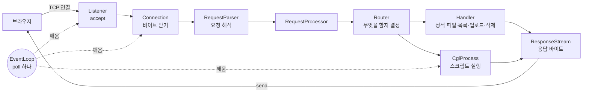

# 레슨 1: 요청 한 개의 여행

이전: [[lessons/00-guide]] · 다음: [[lessons/02-networking-basics]]

브라우저가 `http://127.0.0.1:8080/index.html`을 열 때 서버 안에서 일어나는 일이다. 나머지 레슨은 모두 이 여행의 한 구간을 자세히 설명한다.

## 여덟 단계

1. **손님이 문을 두드린다.** 브라우저가 127.0.0.1:8080에 TCP 연결을 연다. listen 소켓이 "읽을 것 있음(`POLLIN`)"이 되고, 이벤트 루프의 `poll()`이 알려 준다. — `src/core/EventLoop.cpp:47-49`
2. **accept로 손님 전용 소켓.** `Listener`가 `accept`를 한 번 불러 새 fd를 받고 non-blocking으로 바꾼 뒤 `Server`에 넘긴다. `Server`가 그 fd로 `Connection`을 만들어 poll에 등록한다. — `src/core/Listener.cpp:66-98`, `src/core/Server.cpp:51-67`
3. **요청 바이트를 받는다.** 다음 바퀴에 그 소켓이 `POLLIN`이면 `Connection`이 `recv`를 한 번 부른다. 받은 바이트를 버퍼에 붙이고 해석기에 넣는다. 0이나 -1이면 닫는다. — `src/http/Connection.cpp:125-143`
4. **요청을 해석한다.** `RequestParser`가 요청 줄과 헤더를 읽는다. 머리가 끝나면 멈추고(`HEAD_DONE`) 그 경로의 본문 상한을 받은 뒤 본문을 읽는다. 덜 왔으면 다음 `recv`를 기다린다. — `src/http/RequestParser.cpp:202-211`, `:504-523`
5. **무엇을 할지 정한다.** `Router`가 경로를 정규화하고 가장 긴 location을 고른 뒤 return → CGI → 메서드 → 업로드 → 삭제 → 파일 순서로 결정한다. `/index.html`은 `STATIC_FILE`이다. — `src/route/Router.cpp:337-369`
6. **응답을 만든다.** `StaticHandler`가 파일을 읽어 200 응답을 만들고, `RequestProcessor`가 `Date`와, 닫을 때는 `Connection: close`를 붙인다. — `src/handler/StaticHandler.cpp:15-28`, `src/app/RequestProcessor.cpp:291-298`
7. **응답을 보낸다.** `ResponseStream`이 상태 줄·헤더·`Content-Length`를 바이트로 만든다. `Connection`이 `WRITE` 상태가 되어 `POLLOUT`을 요청하고, `POLLOUT`마다 `send`를 한 번 한다. — `src/http/ResponseStream.cpp:45-96`, `src/http/Connection.cpp:167-183`
8. **다음 요청 또는 닫기.** 다 보내면 keep-alive면 `READ_HEAD`로 돌아가고, 아니면 닫는다. 요청을 다 못 읽었으면 `DRAIN`으로 잠시 읽고 버린 뒤 닫는다. — `src/http/Connection.cpp:191-199`

## 폴더(모듈)마다 맡은 일

| 폴더 | 맡은 일 | 하지 않는 일 |
|---|---|---|
| `config/` | 설정 파일을 읽어 검사된 설정 구조체로 만든다 | 네트워크 |
| `core/` | `poll()` 루프, 소켓 열기, 객체 소유, 자식 프로세스 회수, 시그널, 시계 | HTTP 의미 해석 |
| `http/` | 연결의 읽기·쓰기와 상태, 요청 해석, 응답 바이트 만들기 | 요청을 어떻게 처리할지 결정 |
| `app/` | 완성된 요청 하나를 응답 또는 CGI 실행으로 바꾼다 | 소켓 I/O |
| `route/` | 경로 정리, location 고르기, 메서드 검사로 무엇을 할지 결정 | 실제 처리 |
| `handler/` | 결정대로 응답을 만든다 (정적 파일, 목록, 업로드, 삭제, 에러 페이지) | 소켓 I/O |
| `cgi/` | 스크립트 실행, pipe 입출력, 스크립트 출력을 응답으로 | 소켓 I/O, 자식 회수 |
| `fs/` | 파일 종류·크기·권한 확인, 작은 파일 읽기, 새 파일 쓰기 | 경로 결정 |

근거: [[analysis/design]] 2절 "모듈과 책임".

> [!tip] 왜 이렇게 나눴나?
> 한 클래스가 한 가지 일만 하게(단일 책임) 나눴다. `Connection`은 "바이트를 주고받고 지금 상태가 무엇인지"만 안다. 요청을 어떻게 처리할지는 `RequestProcessor`에 묻는다. 그래서 정적 파일 처리를 고쳐도 소켓 코드는 건드리지 않는다.
>
> `EventLoop`는 `IoHandler` 인터페이스만 알고, 소켓인지 CGI pipe인지 모른다. 그래서 루프 하나로 모든 종류의 fd를 다룬다 ([[lessons/07-event-loop]]).
