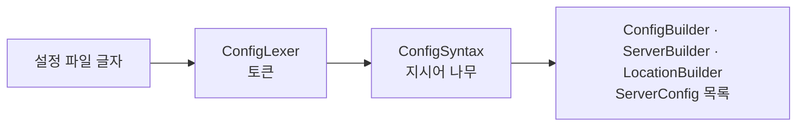

# 레슨 6: 설정 파일 읽기

이전: [[lessons/05-startup]] · 다음: [[lessons/07-event-loop]]

> [!example] 쉬운 예
> 레고 설명서를 읽는다고 하자. ① 글자를 단어 카드로 자른다("server", "{", "listen", "8080", ";"). ② 카드를 괄호에 맞춰 나무 모양으로 쌓는다(server 안에 location). ③ 나무를 보며 실제 부품 상자를 만든다. 이때 "이 부품은 여기 못 들어가요"를 검사한다.



`src/config/ConfigLoader.cpp:36-41` — `tokenizeConfig` → `parseDirectives` → `buildServerConfigs`.

## 6.1 문법: NGINX를 따라서

subject는 NGINX 설정의 `server` 부분을 참고해도 된다고 하고 (raw/subject.md:161), 우리는 NGINX 문법을 따르기로 했다 ([[analysis/design-decisions]] 9). NGINX에 같은 기능이 있으면 그 이름을 쓰고, 없는 기능(업로드 저장 위치, CGI)만 새 지시어를 만들었다.

`conf/default.conf` 일부:

```nginx
server {
    listen 127.0.0.1:8080;
    root www;
    index index.html;
    error_page 404 /errors/404.html;
    client_max_body_size 1m;

    location /files/  { autoindex on; }
    location /docs/   { alias www/documents/; }
    location /old/    { return 301 /about.html; }
    location /upload/ {
        limit_except GET POST DELETE { deny all; }
        upload_store www/upload;
    }
    location /cgi-bin/ {
        limit_except GET POST { deny all; }
        cgi .py /usr/bin/python3;
    }
}
```

| 지시어 | 위치 | 하는 일 (subject 요구) |
|---|---|---|
| `listen` | server | 들을 `interface:port` (raw/subject.md:163). `IPv4:port`나 `port`만 받음 (결정 13) |
| `error_page` | server | 기본 에러 페이지 (raw/subject.md:164) |
| `client_max_body_size` | server, location | 본문 최대 크기 (raw/subject.md:165). 1 이상 100MB 이하 (결정 11) |
| `limit_except` | location | 허용 메서드 (raw/subject.md:167). 없으면 GET·HEAD만 (결정 16) |
| `return` | location | 리다이렉트 (raw/subject.md:168). 301·302·303·307·308만 |
| `root`, `alias` | root: 둘 다, alias: location | 파일을 찾을 디렉토리 (raw/subject.md:169) |
| `autoindex` | server, location | 디렉토리 목록 켜기·끄기 (raw/subject.md:170), 기본 off |
| `index` | server, location | 디렉토리 요청 때 줄 파일 (raw/subject.md:171), 기본 index.html |
| `upload_store` | location | 업로드 허용과 저장 위치 (raw/subject.md:172). 새 지시어 |
| `cgi` | location | 확장자별 CGI (raw/subject.md:173). 새 지시어 |

## 6.2 규칙은 표 하나에

지시어마다 "어디에 올 수 있나, 인자는 몇 개, 블록을 갖나, 여러 번 와도 되나"를 표 하나로 정하고 같은 검사기로 확인한다.

`src/config/DirectiveRules.cpp:52-66`:

```cpp
    // name                    contexts                 min  max        block  repeat
    {"listen",               kInServer,               1,   1,         false, true},
    {"error_page",           kInServer,               2,   kAnyCount, false, true},
    {"location",             kInServer,               0,   kAnyCount, true,  true},
    {"root",                 kInServer | kInLocation, 1,   1,         false, false},
    ...
    {"limit_except",         kInLocation,             1,   kAnyCount, true,  false},
    {"cgi",                  kInLocation,             2,   2,         false, true},
```

> [!tip] 왜 표로?
> 규칙이 if 문 여기저기에 흩어지면 하나를 고칠 때 다른 곳을 빠뜨리기 쉽다. 표 한 곳에 두면 새 지시어를 더할 때 한 줄만 더하면 된다. 오류 메시지에는 파일 이름과 줄 번호가 붙는다 (예: `conf/same-port.conf:10: duplicate listen 127.0.0.1:8080`).

## 6.3 상속과 자동 location

- location에 값이 없으면 server의 값을 물려받는다(root, index, autoindex, client_max_body_size). 그래서 server 블록을 다 읽은 다음에 location을 만든다 (`src/config/ServerBuilder.cpp:122-139`).
- location `/`가 없고 server에 root가 있으면 `/`를 자동으로 만든다 (`ServerBuilder.cpp:135-136`).
- location은 **경로가 긴 것부터** 정렬한다 (`ServerBuilder.cpp:137-138`). 그러면 앞에서부터 처음 맞는 것이 곧 가장 긴 prefix다 ([[lessons/10-routing]]).
- `limit_except`가 없는 location은 GET과 HEAD만 받는다 (`src/config/LocationBuilder.cpp:46-55`).

> [!tip] 왜 기본이 GET·HEAD만?
> 처음 설계는 "limit_except가 없으면 전부 허용"이었다. 그러면 한 줄을 빠뜨린 location의 사이트 파일을 아무나 DELETE로 지울 수 있다. subject와 평가표 모두 기본값을 정하지 않아서 (raw/subject.md:166-167, raw/evaluation-sheet-en.md:73) 사용자가 "파일을 바꾸는 메서드는 적어야 열린다"로 정했다 ([[analysis/design-decisions]] 16).

## 6.4 시작을 거부하는 설정

- 같은 `interface:port`가 두 번: virtual host를 구현하지 않으므로 에러다 (결정 4, 평가표: raw/evaluation-sheet-en.md:108). `src/config/ConfigBuilder.cpp:45-62`.
- 같은 포트에 `0.0.0.0`과 특정 주소: macOS는 둘 다 bind되지만 Ubuntu는 안 되어서 두 OS 모두 거부한다 → [[sources/os-observed-bind]].
- 블록 4단계 이상 중첩: 올바른 중첩은 server > location > limit_except뿐이고, 재귀 파서가 스택을 다 쓰지 않게 막는다 (`src/config/ConfigSyntax.cpp:20`). 10만 단계 중첩 파일로 크래시가 나던 것을 고쳤다 ([[analysis/test-plan]] C-28).
- `index` 값에 `/`: `index ../secret.txt;`로 root 밖을 가리키지 못하게 한다 (결정 14, `src/config/SharedSettings.cpp:56-63`).
- `cgi` 프로그램이 절대 경로가 아님: 스크립트 디렉토리로 이동한 뒤 실행하므로 상대 경로는 못 찾는다 (`src/config/LocationBuilder.cpp:132-138`).

> [!question]- 확인 문제: 설정 파일이 틀렸을 때 서버가 크래시하면 안 되는 이유와 우리 서버의 동작은?
> 평가 중 비정상 종료는 0점이다 (raw/evaluation-sheet-en.md:24). 우리는 원인 메시지(파일:줄)를 출력하고 종료 코드 1로 정상 종료한다. 크래시가 아니라 시작 거부다. 평가자는 설정 파일만 고칠 수 있으므로 메시지로 고칠 곳을 알려 주는 것이 중요하다.
