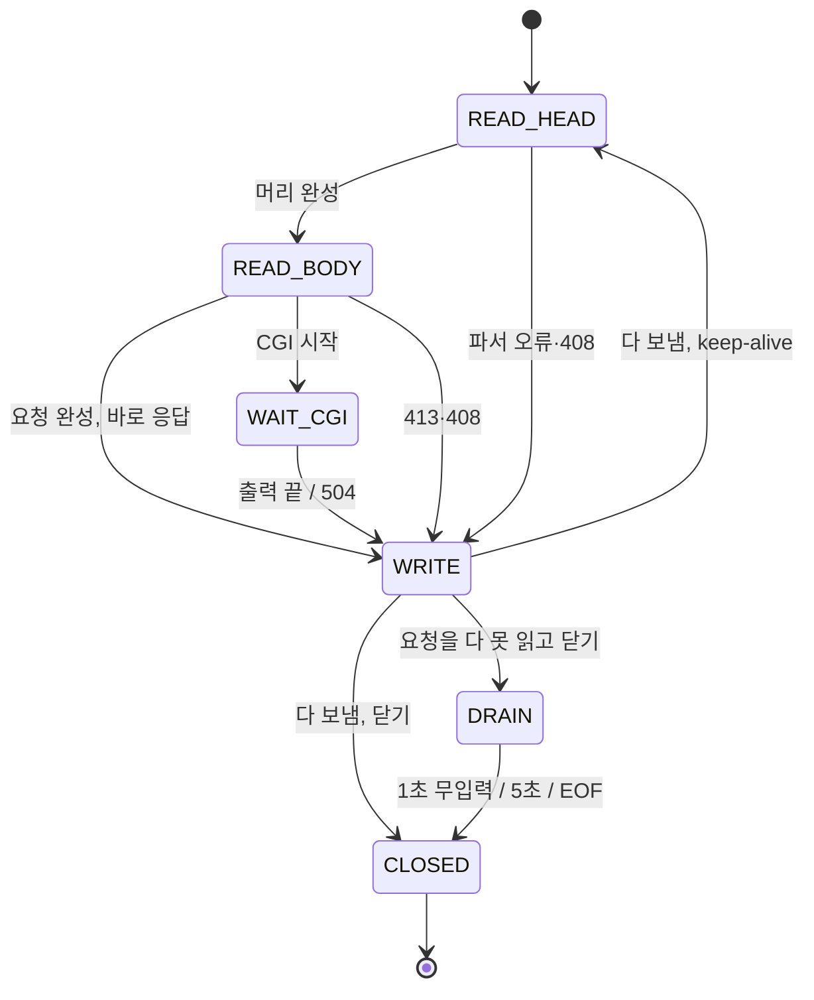

# 레슨 8: 연결 하나의 일생

이전: [[lessons/07-event-loop]] · 다음: [[lessons/09-request-parser]]

> [!example] 쉬운 예
> 식당 테이블 하나를 생각하자. "주문 받는 중" → "요리 기다리는 중" → "음식 나르는 중" → 다 먹었으면 다음 주문을 받거나 손님이 나간다. 테이블은 언제나 이 중 하나의 상태에 있고, 상태마다 할 일과 기다려 주는 시간이 다르다.



| 상태 | poll에 요청하는 것 | 시간 제한 (넘으면) |
|---|---|---|
| `READ_HEAD` | `POLLIN` | 첫 바이트 전: 15초 (그냥 닫음) / 첫 바이트부터: 30초 (408) |
| `READ_BODY` | `POLLIN` | 30초 동안 새 바이트 없음 (408) |
| `WAIT_CGI` | 0 (CGI pipe가 따로 등록) | CGI 10초 (504) |
| `WRITE` | `POLLOUT` | 30초 동안 전송 진행 없음 (닫음) |
| `DRAIN` | `POLLIN` | 1초 무입력 또는 총 5초 (닫음) |

코드: `src/http/Connection.cpp:69-74` (wantedEvents), `:134-158` (hasTimedOut). 값: `include/core/Limits.hpp`.

## 8.1 받기

`src/http/Connection.cpp:162-180`:

```cpp
void Connection::receiveOnce() {
  char buffer[limits::kRecvBufferSize];               // 65536
  const ssize_t received = recv(fd_, buffer, sizeof(buffer), 0);
  if (received <= 0) { changeState(CLOSED); return; }  // 0도 -1도 닫기, errno 안 봄
  lastProgress_ = now_;
  if (state_ == DRAIN) return;                         // 버리는 중이면 해석 안 함
  if (state_ == READ_HEAD && !parser_.hasStarted()) stateSince_ = now_;
  inBuffer_.append(buffer, received);
  parseInput();
}
```

## 8.2 타임아웃: 무한히 매달리지 않기

- **머리는 첫 바이트부터 30초**: 5초마다 1바이트씩 보내는 손님(slowloris 같은 공격)이 연결을 붙잡지 못하게, 머리는 "처음부터 얼마나 지났는지"로 잰다 (`Connection.cpp:124-133`, [[analysis/test-plan]] N-24).
- **본문·전송은 무진행 30초**: 큰 파일은 오래 걸릴 수 있으니 "멈춰 있던 시간"만 잰다.
- **요청을 시작했으면 408, 아니면 그냥 닫기** (`Connection.cpp:110-116`). 408을 보낼 때는 오류 로그에도 한 줄 남긴다. 불완전한 요청에는 닫기 전에 에러 응답을 보내도 된다 (MAY, RFC 9112 8절, raw/rfc9112.txt:1253-1255).
- **"같다"가 아니라 "크다"로 비교**: 시계가 초 단위라 경과가 N초로 보여도 실제로는 초가 막 바뀐 직후일 수 있다. N보다 커야 진짜 N초가 넘은 것이다 (`Connection.cpp:124-133`). 처음에 `>=`로 썼다가 DRAIN 1초가 거의 0초가 되는 것을 테스트가 잡아서 고쳤다.

## 8.3 응답 뒤: 유지, 닫기, DRAIN

`src/http/Connection.cpp:228-236`:

```cpp
void Connection::finishResponse() {
  if (!keepAlive_) {
    changeState(requestConsumed_ ? CLOSED : DRAIN);  // 다 못 읽었으면 버리고 닫기
    return;
  }
  parser_.reset();
  changeState(READ_HEAD);
  parseInput();       // pipelining: 이미 받아 둔 다음 요청을 바로 해석
}
```

> [!example] 쉬운 예 — DRAIN
> 손님이 아직 말하고 있는데 "그만!" 하고 문을 쾅 닫으면, 손님은 내가 마지막에 한 말(응답)을 못 듣는다. 그래서 하던 말을 잠깐 들어 주며(읽고 버리며) 기다리다가 문을 닫는다.

> [!tip] 왜 DRAIN? (실측 근거)
> 서버가 TCP 연결을 바로 닫으면 클라이언트가 마지막 응답을 못 읽을 위험이 크다. 아직 받지 않은 데이터가 있으면 TCP가 reset을 보내 응답을 지울 수 있다 (RFC 9112 9.6, raw/rfc9112.txt:1539-1546). NGINX는 이때 `shutdown()`으로 쓰기 쪽만 먼저 닫지만 `shutdown`은 허용 함수가 아니다 (raw/subject.md:113) → [[sources/nginx-src-lingering-close]].
>
> 그래서 직접 쟀다. 10MB 본문에 413을 보내고 바로 `close()`하면 macOS에서 curl 한 번이 응답을 받지 못했고 Python 클라이언트는 reset을 받았다 (raw/close-after-413-observed.md:359-363, raw/close-after-413-observed.md:370-374). 읽고 버리다가 닫으면 Ubuntu와 macOS에서 12번 모두 413을 받았다 (raw/close-after-413-observed.md:225-256, raw/close-after-413-observed.md:388-419) → [[sources/close-after-413-observed]].

- **언제 유지하나**: HTTP/1.1이고 `Connection: close`가 없으면 유지한다. HTTP/1.0은 `keep-alive`가 있어도 닫는다 (`src/http/RequestParser.cpp:174-183`). RFC 9112 9.3은 1.0의 keep-alive를 받아들일지 수신자에게 맡기고 (raw/rfc9112.txt:1353-1359), siege 기본 설정은 HTTP/1.1이다 (raw/siegerc.in:213) **(판단)**.
- **400이면 닫기**: 잘못된 경로(`..`로 root 위)는 NGINX처럼 닫는다 (결정 2, `src/app/RequestProcessor.cpp:73-75`). 404·405는 요청을 다 읽었으니 유지한다.
- **파서 오류와 408은 항상 닫기**: 요청의 끝을 믿을 수 없으니 이어지는 바이트를 다음 요청으로 읽으면 안 된다. 서버는 요청 본문을 다 읽거나 응답 뒤 닫아야 한다 (MUST, raw/rfc9112.txt:1374-1377).

> [!example] 쉬운 예 — pipelining
> 손님이 한 번에 "김밥, 라면, 떡볶이"를 주문했다. 라면이 먼저 됐어도 김밥부터 내야 한다. 우리 서버는 응답을 보내는 동안(`WRITE`) 새 요청을 읽지 않고, 다 보낸 뒤 버퍼에 남은 다음 요청을 해석한다. 그래서 순서가 자동으로 지켜진다.

## 8.4 local redirect와 CGI 대기

`handleOutcome`은 결과가 응답이면 보내기 시작하고, CGI면 `WAIT_CGI`로 간다. CGI가 "다른 경로를 대신 보여 줘"(local redirect)라고 하면 그 경로로 다시 처리하되 10번을 넘으면 500이다 (`Connection.cpp:238-260`). 자기 자신을 가리키는 스크립트가 무한 반복하지 않게 하는 장치다.

`WAIT_CGI` 동안에는 루프 한 바퀴마다 `checkTimeout` → `followCgi`로 끝났는지 확인한다 (`Connection.cpp:262-276`).

> [!tip] 왜 콜백이 아니라 매 바퀴 확인?
> 처음 설계는 CGI가 끝나면 알려 주는 콜백이었다. 그러면 pipe의 `onEvent` 안에서 CGI 객체를 지우는 일이 생긴다. 실행 중인 객체를 그 안에서 지우면 위험하다. 바퀴 끝(이벤트 처리 밖)에서 확인하면 이 문제가 없고 인터페이스도 하나 줄어든다. 응답이 늦어지는 시간은 그 바퀴 끝까지뿐이다 ([[analysis/design]] 9절 "완료 확인").
