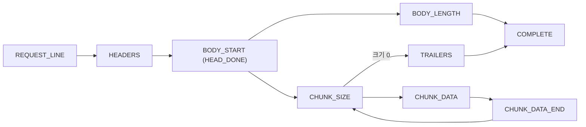

# 레슨 9: 요청 해석기

이전: [[lessons/08-connection]] · 다음: [[lessons/10-routing]]

> [!example] 쉬운 예
> 편지가 우편함에 조각조각 들어온다고 하자. 조각이 올 때마다 퍼즐을 맞추다가, 첫 줄이 다 오면 "누가 무엇을 원하는지" 읽고, 빈 줄이 오면 "이제 첨부물"이라는 것을 안다. 아직 덜 왔으면 "더 기다릴게"라고만 한다.

## 9.1 상태기계



`feed(buffer)`는 받은 바이트를 가능한 만큼 소비하고 네 가지 중 하나를 돌려준다: `NEED_MORE`(더 필요), `HEAD_DONE`(머리 끝), `DONE`(요청 완성), `ERROR`(상태 코드와 함께) (`src/http/RequestParser.cpp:202-211`, `:248-261`). 자세한 규칙: [[concepts/request-parsing]].

> [!tip] 왜 머리에서 한 번 멈추나? (HEAD_DONE)
> 본문 상한(`client_max_body_size`)은 location마다 다르다. 어느 location인지는 경로를 봐야 안다. 그래서 머리가 끝나면 멈추고, `Connection`이 그 요청의 location 상한을 알려 준 뒤 본문을 읽는다 (`src/http/Connection.cpp:150-153`). 덕분에 `Content-Length`가 상한보다 크면 **본문을 한 바이트도 읽기 전에** 413을 보낸다 (`RequestParser.cpp:349`).

## 9.2 RFC가 여러 동작을 허용할 때 우리 선택

기준은 결정 13 때 사용자가 정한 "요구사항에 맞고 안전한 쪽"이다 ([[analysis/design]] 6절).

| 상황 | RFC | 우리 선택 | 이유 |
|---|---|---|---|
| 줄 끝이 LF 하나 | 받아도 됨 (MAY, raw/rfc9112.txt:283-285) | 받는다 | nc·telnet 시연이 안전. 앞에 프록시가 없어 해석이 갈릴 상대가 없음 |
| LF 없는 CR | 잘못된 것으로 봐야 함 (MUST, raw/rfc9112.txt:287-291) | 400 | RFC 그대로 |
| 요청 줄 구분 공백 | 관대한 파싱은 smuggling 위험 (raw/rfc9112.txt:377-388) | SP 하나만 | 안전한 쪽 |
| 헤더 이름과 `:` 사이 공백 | 400 (MUST, raw/rfc9112.txt:714-719) | 400 | RFC 그대로 |
| obs-fold | 거부 또는 치환 (raw/rfc9112.txt:746-751) | 400 | 안전한 쪽 |
| TE와 CL이 함께 | 거부해도 됨 + 응답 뒤 닫기 MUST (raw/rfc9112.txt:880-884) | 400 후 닫기 | smuggling 방어 |
| `HTTP/1.2` | 1.1로 처리 (SHOULD, raw/rfc9110.txt:2061-2065) | 1.1로 | RFC 그대로 |
| `HTTP/2.0` | 505 (raw/rfc9110.txt:7908-7910) | 505 | |
| 모르는 메서드 | 501 (SHOULD, raw/rfc9110.txt:3799-3801) | 501 | UNKNOWN 요청에 크래시 없음 (raw/evaluation-sheet-en.md:80) |

`src/http/RequestParser.cpp:269-278` — 줄 하나 꺼내기:

```cpp
LineStatus RequestParser::takeLine(const std::string& buffer, std::string& line) {
  const std::string::size_type newline = buffer.find('\n', consumed_);
  if (newline == std::string::npos) return LINE_INCOMPLETE;   // 아직 줄이 안 끝남
  line.assign(buffer, consumed_, newline - consumed_);
  consumed_ = newline + 1;
  if (!line.empty() && line[line.size() - 1] == '\r') line.erase(line.size() - 1);
  return line.find('\r') == std::string::npos ? LINE_READY : LINE_INVALID;  // 남은 CR = bare CR
}
```

## 9.3 크기 상한: 거대한 요청으로 괴롭히지 못하게

| 무엇 | 상한 | 넘으면 | 근거 |
|---|---|---|---|
| 요청 줄 | 8192 B | 414 (메서드가 너무 길면 501) | 최소 8000 지원 권장, 넘으면 414 MUST (raw/rfc9112.txt:393-399) |
| 헤더 전체 | 16384 B | 431 | 너무 크면 4xx MUST (raw/rfc9110.txt:1568-1572), 431은 **(판단)** → [[sources/rfc6585]] |
| chunk 크기 줄 | 4096 B | 400 | 확장 길이 제한 권고 (raw/rfc9112.txt:1108-1113) |
| 본문 | location 설정 (기본 1MB, 최대 100MB) | 413 | 결정 11 |
| 숫자 변환 | size_t를 넘으면 | 400 | 오버플로 방지 MUST (raw/rfc9110.txt:3251-3254) |

> [!tip] 왜 본문 상한이 100MB?
> 본문은 메모리에 다 모은 뒤 처리한다(구현 단순). 메모리를 256MB로 제한한 컨테이너에서 1GB를 모으려 하자 `std::bad_alloc` 예외 없이 프로세스가 `Killed`로 끝났다 (raw/design-checks-observed.md:119-123). 서버가 끝나면 0점이므로 (raw/evaluation-sheet-en.md:24) 예외 처리로는 못 막고 상한으로 막는다 ([[analysis/design-decisions]] 11). `Content-Length`를 알면 미리 `reserve`해서 문자열이 두 배로 커지며 복사되는 것도 피한다 (`RequestParser.cpp:357`).

## 9.4 Host 검사와 연결 유지 결정

`src/http/RequestParser.cpp:504-523`:

```cpp
bool RequestParser::finishHead() {
  const std::size_t hosts = headers.count(header_name::kHost);
  if ((hosts == 0 && request_.version == request_parser::kHttp11) ||  // 1.1에 Host 없음
      hosts > 1 ||                                                     // 두 개 이상
      (hosts == 1 && !isHostValue(*headers.first(header_name::kHost)))) // 이상한 값
    return fail(http_status::kBadRequest);
  if (!decideBodyLength()) return false;
  request_.persistent = keepsConnection(request_);
  state_ = BODY_START;   // 여기서 멈춤 → HEAD_DONE
  return false;
}
```

> [!question]- 확인 문제: HTTP/1.0 POST에 Content-Length가 없으면?
> 400이다. RFC 1945는 모든 HTTP/1.0 POST에 유효한 Content-Length가 필요하고, 길이를 알 수 없으면 400을 보내야 한다고 한다 (raw/rfc1945.txt:1763-1765, `RequestParser.cpp:570-572`).
