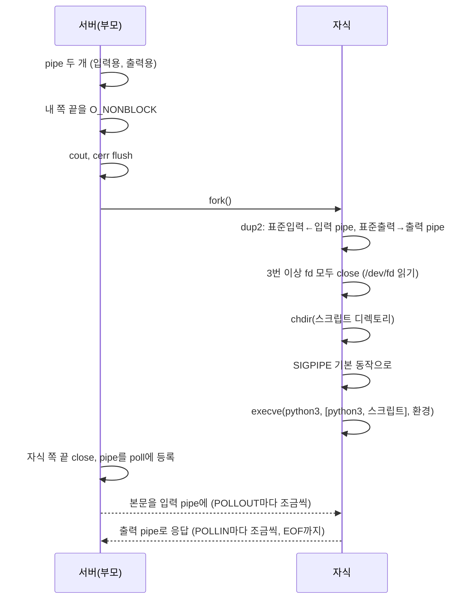

# 레슨 13: CGI — 다른 프로그램에게 일 맡기기

이전: [[lessons/12-upload-delete]] · 다음: [[lessons/14-resilience]]

> [!example] 쉬운 예
> 우리 식당(서버)은 밥은 잘하지만 케이크는 못 만든다. 케이크 주문이 오면 옆 가게 제빵사(Python 스크립트)에게 주문서 메모(환경 변수)와 재료(본문)를 넘긴다. 제빵사가 창구(pipe)로 케이크를 내보내면 우리가 포장(HTTP 응답)해서 손님에게 준다. 제빵사가 10초 넘게 안 나오면 "죄송합니다(504)"라고 하고 제빵사를 돌려보낸다.

자세한 규칙과 근거: [[concepts/cgi]].

## 13.1 스크립트 찾기

location에 `cgi .py /usr/bin/python3`가 있으면, 경로를 앞에서부터 조각 단위로 보며 마지막 조각이 `.py`로 끝나고 실제 일반 파일인 첫 지점을 스크립트로 본다. 나머지는 `PATH_INFO`다. 예: `/cgi-bin/env.py/extra/path` → 스크립트 `/cgi-bin/env.py`, PATH_INFO `/extra/path` (`src/route/Router.cpp:236-259`). 서버가 경로의 앞부분을 스크립트로 정하고 나머지는 스크립트가 해석한다 (raw/rfc3875.txt:457-464).

## 13.2 메타변수(환경 변수)

클라이언트가 보낸 요청 전체와 인자를 CGI가 쓸 수 있어야 한다 (raw/subject.md:178). 요청 정보를 환경 변수로 넘긴다 (`src/cgi/CgiEnv.cpp:127-166`).

| 변수 | 값 |
|---|---|
| `REQUEST_METHOD` | GET, POST … |
| `QUERY_STRING` | `?` 뒤 그대로 (풀지 않음) |
| `CONTENT_LENGTH`, `CONTENT_TYPE` | 본문이 있을 때. chunked는 푼 뒤의 길이로 다시 계산 (MUST, raw/rfc3875.txt:1093-1097) |
| `SCRIPT_NAME`, `PATH_INFO`, `PATH_TRANSLATED` | 스크립트 URI, 그 뒤 경로, 그 경로의 파일 위치(절대 경로일 때만) |
| `SERVER_NAME`, `SERVER_PORT`, `REMOTE_ADDR` | 연결의 두 끝 주소 (`getsockname`, `accept` 결과) |
| `HTTP_*` | 요청 헤더. 이름을 대문자로, `-`를 `_`로 (raw/rfc3875.txt:1038-1042). 같은 헤더는 `, `로 합침 (MUST, raw/rfc3875.txt:1044-1046). `Authorization`·`Content-Length`·`Content-Type`은 넣지 않음 (SHOULD, raw/rfc3875.txt:1052-1055) |
| `REDIRECT_STATUS=200`, `SCRIPT_FILENAME` | php-cgi용. 없으면 php-cgi가 실행을 거부함 → [[sources/php-cgi-observed-env]] |

> [!tip] 넘기지 않는 헤더 두 가지 더 (2026-10-29, webserv `cad952e`)
> - `Proxy` 헤더: `HTTP_PROXY`가 되면 많은 라이브러리가 이것을 바깥으로 나가는 요청의 프록시로 쓴다. 공격자가 스크립트의 바깥 요청을 자기 서버로 돌릴 수 있다("httpoxy", NVD CVE-2016-5385).
> - 이름에 `_`가 든 헤더: `-`가 `_`로 바뀌므로 `X_Forwarded_For`와 `X-Forwarded-For`가 같은 `HTTP_X_FORWARDED_FOR`가 된다. 클라이언트가 앞단 프록시가 넣은 값을 바꿔칠 수 있다 **(판단)**. NGINX도 기본 설정에서 이런 헤더를 무시한다 (raw/nginx-core-module.md:2060-2066).
> - 서버가 받은 헤더를 모두 변수로 만들 의무는 없다 (raw/rfc3875.txt:1051-1052). 코드: `src/cgi/CgiEnv.cpp:56-58`, `:77-78` (`13982df` 기준).

쿠키도 `HTTP_COOKIE`로 넘어가므로 보너스 세션은 CGI 예제로 보여 준다 ([[analysis/design-decisions]] 8, `www/cgi-bin/session.py`) → [[concepts/bonus]].

## 13.3 실행: pipe, fork, dup2, execve

> [!example] 쉬운 예
> **pipe**는 한쪽 끝으로 넣으면 다른 끝으로 나오는 관이다. **fork**는 분신술이다. 나와 똑같은 내가 하나 더 생긴다. **dup2**는 분신의 입과 귀를 관에 연결하는 것, **execve**는 분신이 제빵사로 완전히 변신하는 것이다(변신하면 원래 나로 돌아오지 않는다).



코드: `src/cgi/CgiProcess.cpp:147-180` (start), `:212-230` (runChild).

> [!tip] 하나씩 이유
> - **fork는 CGI에만**: 과제 규칙이다 (raw/subject.md:144).
> - **fork 직전 flush**: 출력 버퍼에 글자가 남아 있으면 자식이 끝날 때(`std::exit`) 그 글자를 한 번 더 내보냈다. macOS와 Ubuntu 모두 그랬다 (raw/design-checks-observed.md:183-194).
> - **3번 이상 fd 닫기**: 닫지 않으면 스크립트가 다른 손님의 소켓을 물려받아 열어 둔다. 보통은 `FD_CLOEXEC`를 쓰지만 그 설정(`F_SETFD`)은 허용 플래그가 아니다 (raw/subject.md:155-157). 그래서 자식에서 허용 함수 `opendir`·`readdir`로 `/dev/fd`를 읽어 3번 이상을 닫는다 (`CgiProcess.cpp:90-105`). 번호를 끝까지 다 닫는 것보다 낫다(컨테이너 fd 한도 20480).
> - **chdir**: 스크립트가 상대 경로 파일을 읽을 수 있게 스크립트 디렉토리에서 실행한다 (raw/subject.md:181, raw/evaluation-sheet-en.md:89).
> - **SIGPIPE 되돌리기**: 서버는 SIGPIPE를 무시하지만([[lessons/14-resilience]]), 스크립트는 보통 동작을 받게 한다.
> - **execve 실패하면 std::exit(1)**: `exit`·`_exit`가 허용 목록에 없어 subject 51줄을 근거로 `std::exit`를 쓴다 ([[analysis/design-decisions]] 12). 부모는 출력 없이 EOF를 받으니 502가 된다. 흔한 실패를 줄이려고 `fork` 전에 `access`로 스크립트를 읽을 수 있는지, 프로그램이 있고 실행 가능한지 검사한다(403·404, `src/app/RequestProcessor.cpp:110-116`).
> - **자식의 모든 예외를 잡기**: 자식에서 예외(`bad_alloc`)가 풀려 나가면 자식이 서버 코드로 돌아가 같은 소켓을 처리하는 두 번째 서버가 된다. 그래서 자식 코드 전체를 `try`로 감싸고 무조건 `std::exit`한다 (`:212-230`, [[analysis/test-plan]] 8절 R1).

## 13.4 pipe 입출력도 poll로

CGI pipe도 기다릴 수 있는 fd라 poll을 거쳐야 한다 (raw/evaluation-sheet-en.md:54). `CgiStdin`은 POLLOUT마다 본문을 64KB 이하로 한 번 쓰고, `CgiStdout`은 POLLIN마다 한 번 읽는다 (`src/cgi/CgiPipes.cpp:22-43`, `:63-79`).

- **POLLHUP만 와도 읽는다**: 스크립트가 끝나면 POLLHUP이 오는데 아직 못 읽은 데이터가 남아 있을 수 있다. macOS는 이때 POLLIN과 POLLHUP을, Ubuntu는 POLLHUP만 보고했다 (raw/os-observed-pipe-poll.md:178, raw/os-observed-pipe-poll.md:193). 그래서 POLLIN이 없어도 읽어서 0(EOF)을 확인한다.
- **EOF까지 읽는다**: 스크립트가 `Content-Length`를 줘도 EOF까지 읽는다. subject는 "Content-Length가 없으면 EOF가 끝"이라고 하지만 (raw/subject.md:180), RFC 3875는 서버가 EOF까지 모두 읽어야 한다고 한다 (MUST, raw/rfc3875.txt:1521-1524).
- **출력 상한 16MB**: 출력을 메모리에 모으므로 끝없이 출력하는 스크립트를 막는다. 넘으면 502다.
- **본문을 안 읽고 끝나는 스크립트**: 입력 pipe에 쓰면 -1이 돌아오고(SIGPIPE는 무시), 입력 pipe를 닫는다.

## 13.5 스크립트 출력 해석

```text
Status: 404 Not Found         ← 선택. 없으면 200
Content-Type: text/html       ← 문서면 필수
Set-Cookie: a=1
                              ← 빈 줄
<h1>...</h1>
```

| 출력 | 종류 | 서버가 하는 일 |
|---|---|---|
| `Content-Type` + 본문 | 문서 | `Status`(없으면 200)로 응답. 204·304면 본문 버림 |
| `Location: /경로`만 | local redirect | 그 경로를 서버가 다시 처리(GET, 원래 HEAD면 HEAD) (raw/rfc3875.txt:1310-1314) |
| `Location: http://…`만 | client redirect | 302 + Location (MUST, raw/rfc3875.txt:1324-1326) |
| `Location: http://…` + 3xx Status + 본문 | 문서 있는 redirect | 그 상태 코드로 (raw/rfc3875.txt:1330-1335) |
| 빈 줄 없음, 이상한 줄, Content-Type 없는 문서 | 잘못됨 | 502 |

코드: `src/cgi/CgiOutput.cpp:289-320` (parseCgiOutput), `:246-261` (redirectKind).

- 스크립트의 `Content-Length`·`Date`·`Connection`·`Transfer-Encoding`은 버리고 서버 값을 쓴다. 서버는 충돌하는 헤더를 해결해야 한다 (SHOULD, raw/rfc3875.txt:1493-1498). 연결 하나에만 속하는 `Keep-Alive`·`Proxy-Connection`·`TE`·`Upgrade`도 버린다. 목록은 RFC 9110이 중개자에게 지우라고 한 것이다 (raw/rfc9110.txt:2604-2617, CGI 서버에 쓰는 것은 **판단**). 코드: `src/cgi/CgiOutput.cpp:33-35` (`13982df` 기준).
- `Set-Cookie` 여러 줄은 합치지 않고 그대로 옮긴다. 합치면 쿠키 뜻이 바뀔 수 있다 (raw/rfc6265.txt:315-319). 그래서 헤더 저장 구조(`HeaderMap`)가 같은 이름을 여러 개 담는다.
- 헤더 값에 제어 문자가 있으면 502다. CR이 들어가면 응답이 쪼개질 수 있다([[lessons/11-response]]).
- 판정은 종료 코드가 아니라 **출력 형식**으로 한다. 그래서 `waitpid` 종료 상태 매크로(허용 여부 불분명)를 쓸 필요가 없다. php-cgi는 파일이 없을 때 `Status: 404`를 올바르게 출력하고 종료 코드 255로 끝나는데, 종료 코드로 판정했다면 이 404가 사라졌을 것이다 **(판단)** → [[concepts/cgi]] 5절.

## 13.6 끝내기와 좀비

> [!example] 쉬운 예 — 좀비
> 숙제를 다 한 학생이 선생님 확인 도장을 받아야 집에 갈 수 있다고 하자. 선생님이 도장을 안 찍어 주면 그 학생은 할 일도 없이 교실에 계속 남아 있다. 이게 **좀비 프로세스**다. 부모가 `waitpid`로 "끝났구나" 하고 확인해 줘야 사라진다 (raw/posix-exit.md:58-64).

- `CgiProcess`가 사라질 때: 출력이 아직 안 끝났으면 `SIGKILL`(잡을 수 없는 강제 종료)을 보내고, pid를 `ChildReaper`에 넘긴다 (`src/cgi/CgiProcess.cpp:125-145`). 출력을 다 낸 자식은 마무리 중일 수 있어 죽이지 않고 넘기기만 한다.
- `ChildReaper::reap()`: 매 바퀴 `waitpid(pid, &status, WNOHANG)`으로 "끝난 사람?"만 묻고 기다리지 않는다 (`src/core/ChildReaper.cpp:31-39`). `WNOHANG` 없이 기다리면 루프가 멈춘다.
- 서버가 끝날 때 `~ChildReaper`가 남은 자식을 `SIGKILL`하고 기다린다.
- 무한 루프 스크립트: 10초가 지나면 504를 보내고 자식을 죽인다 (`CgiProcess.cpp:198-200`). 그동안 다른 요청은 바로 처리된다(모의 평가에서 루프 중 GET 0.0002초).

> [!info] 평가 때
> "에러 스크립트에도 서버가 죽지 않나요?" → 문법 오류·빈 출력·헤더 없음·abort·16MB 초과 출력은 모두 502, 무한 루프는 504이고 서버는 계속 응답한다. 직접 만든 잘못된 스크립트 9개로 확인했다 → [[analysis/mock-evaluation]].
